# Lab 3 – Distributed Relational Databases with CockroachDB

**Course:** Distributed Database & Information Systems (DDIS)  
**University:** HAW Kiel  
**Team 8**  
**Database:** CockroachDB v23.1.11 on Kubernetes

---

## Overview

In Lab 3, we set up CockroachDB as a distributed relational database on Kubernetes, loaded the same fashion shop dataset used in Lab 1 (PostgreSQL), and repeated the API load test to compare throughput between a non-distributed and a distributed database system. We then configured geo-replication by assigning locality labels to CockroachDB nodes based on simulated cloud regions (europe, americas, asia) and applied zone constraints to control data placement across regions.

---

## Task 1 – Setup Distributed Database

### 1.1 StatefulSet Configuration

The CockroachDB cluster is deployed as a Kubernetes StatefulSet. Each node (DBS instance container) is configured with:

- **Memory:** 6 GiB (requests and limits)
- **CPU:** 2 cores (requests and limits)
- **Storage:** 20 GiB PVC on `ceph-hdd` storage class
- **Replication factor:** 3 (default in CockroachDB — each range has 3 replicas)
- **Image:** `cockroachdb/cockroach:v23.1.11`

The StatefulSet YAML is at `lab3/k8s/cockroachdb-statefulset.yaml`.

```yaml
replicas: 3
resources:
  requests:
    memory: "6Gi"
    cpu: "2"
  limits:
    memory: "6Gi"
    cpu: "2"
```

### 1.2 Cluster Initialization

After deploying the StatefulSet, the cluster is bootstrapped:

```bash
kubectl exec -it cockroachdb-0 -n team8 -- \
  /cockroach/cockroach init --insecure --host=cockroachdb-0.cockroachdb
```

### 1.3 Node Locality Labels

As part of the StatefulSet startup command, each pod is assigned a **locality label** based on its pod index. This tells CockroachDB which physical region/zone each node belongs to — used later for zone constraint placement (Task 4). The locality is set at node startup and cannot be changed without restarting the node.

```bash
POD_NAME=$(hostname)
NODE_NUM=$(echo $POD_NAME | grep -o '[0-9]*$')

if [ "$NODE_NUM" -le "1" ]; then
  LOCALITY="region=europe,zone=europe-a"
elif [ "$NODE_NUM" -le "3" ]; then
  LOCALITY="region=americas,zone=americas-a"
else
  LOCALITY="region=asia,zone=asia-a"
fi
```

This mirrors the Kubernetes cluster node labels used in the lab:

| K8s Node | CockroachDB Pod | Region | Zone |
|----------|----------------|--------|------|
| k1 | cockroachdb-0 | europe | europe-a |
| k2 | cockroachdb-1 | europe | europe-a |
| k3 | cockroachdb-2 | americas | americas-a |
| k4 | cockroachdb-3 | americas | americas-a |
| k5 | cockroachdb-4 | asia | asia-a |
| k6 | cockroachdb-5 | asia | asia-a |

> **Note:** These locality labels configure which *node* is in which region. The actual geo-partitioning of data (deciding which rows go to which region) is configured separately in Task 4.

Locality was verified with:

```sql
SELECT node_id, locality FROM crdb_internal.gossip_nodes ORDER BY node_id;
```

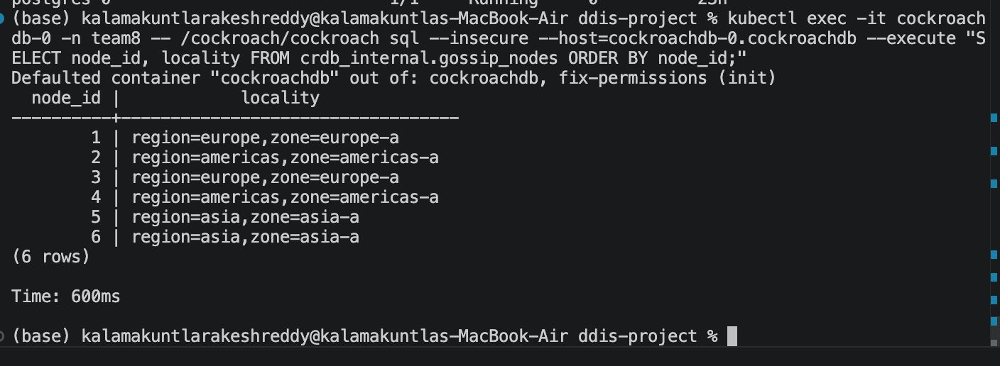

### 1.4 Kubernetes Pods Running

```bash
kubectl get pods -n team8
```

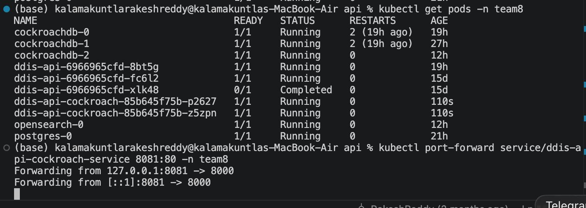

**Port-forwarding** was set up to access all services locally:

```bash
# 1. CockroachDB Admin UI (port 8080 inside cluster → local 9090)
kubectl port-forward service/cockroachdb-public 9090:8080 -n team8

# 2. Fashion shop API
kubectl port-forward service/ddis-api-cockroach-service 8081:80 -n team8

# 3. Locust load test web UI
kubectl port-forward pod/loadtest-pod 8089:8089 -n team8
```

> Note: Port 8080 was already in use locally, so the Admin UI was forwarded to 9090.

### 1.5 Data Loading

The fashion shop dataset was loaded into the `fashion_shop` database in CockroachDB:

- **users:** 540,357 rows
- **items:** 44,446 rows
- **sales:** 10,000,000 rows

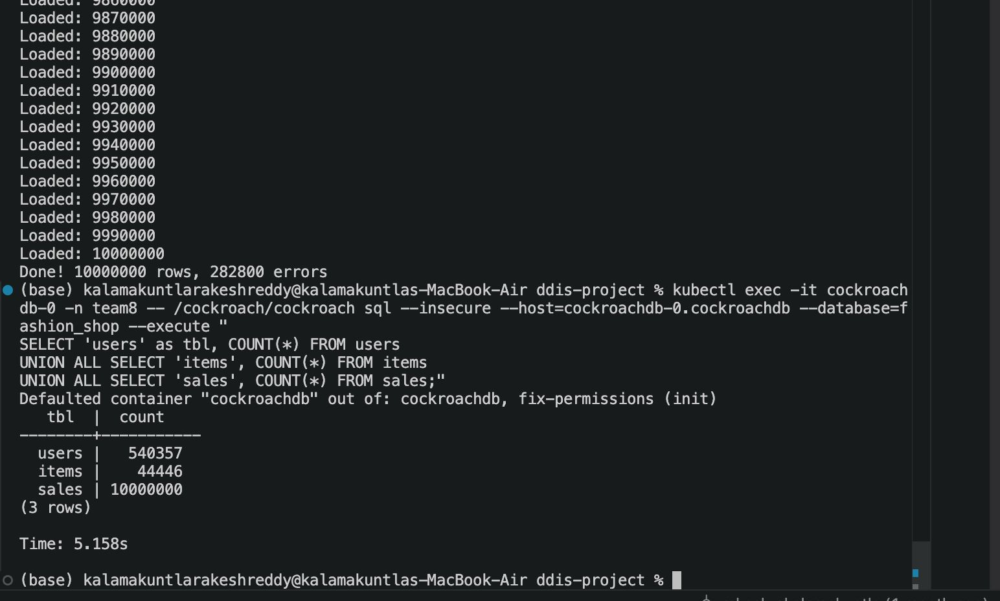

### 1.6 API Verification

The API (Docker image `rakeshreddykalamakuntla/ddis-api:v23`) was deployed and verified:

```bash
curl "http://localhost:8081/items?page_size=3" | python3 -m json.tool
```

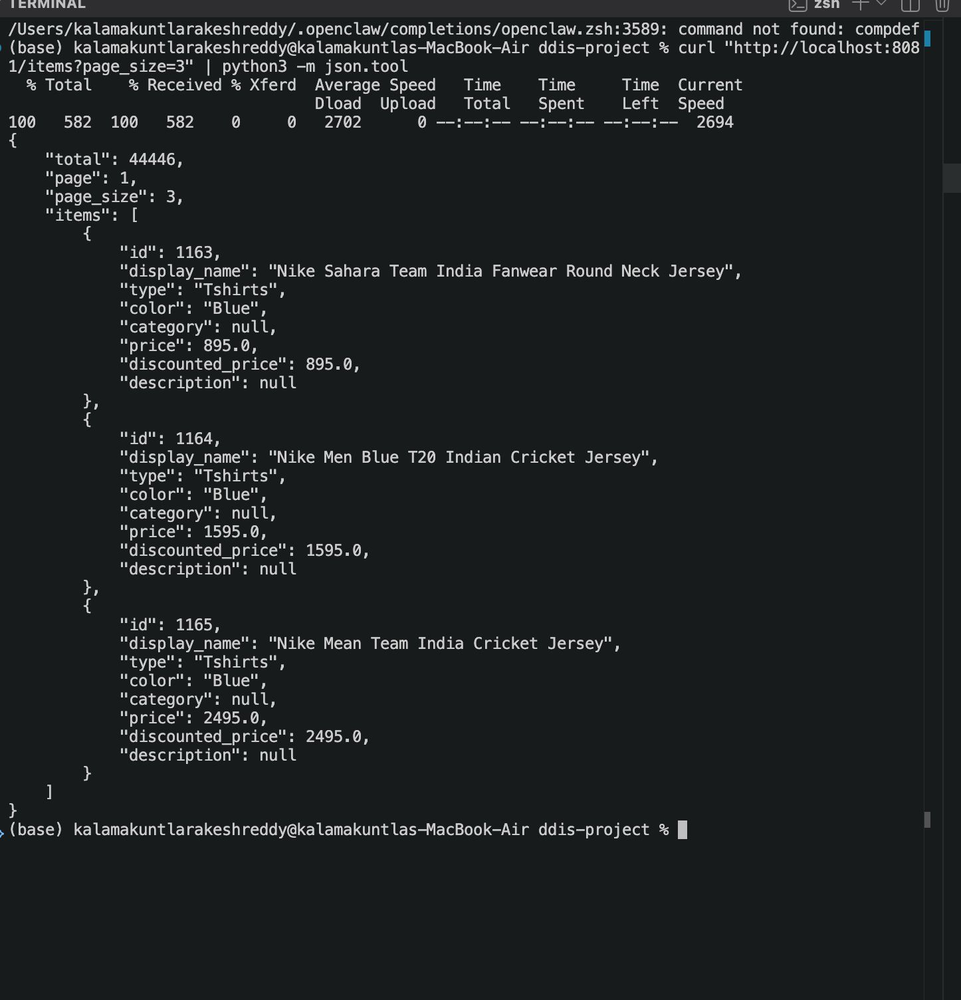

```bash
curl "http://localhost:8081/item/20676" | python3 -m json.tool
curl -H "Authorization: Bearer $TOKEN" "http://localhost:8081/user/chattpet" | python3 -m json.tool
```

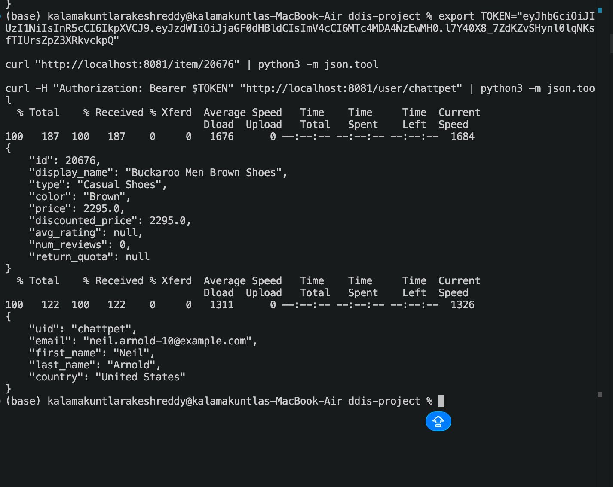

Sale creation was verified:

```bash
$response = Invoke-WebRequest -Method POST \
  -Headers @{"Authorization"="Bearer $TOKEN"} \
  -ContentType "application/json" \
  -Body '{"user_id":"chattpet","item_id":1163,"quantity":1}' \
  "http://localhost:8081/sales/"
```

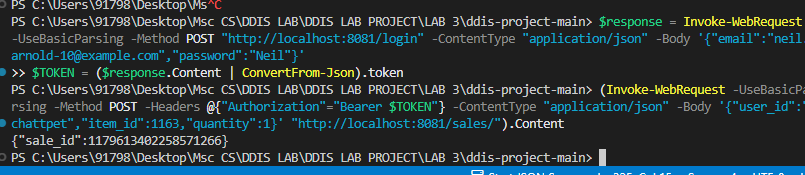

### 1.7 CockroachDB Admin UI

Accessible at `http://localhost:9090`.

**During exploration (5 live, 1 dead — cockroachdb-5 temporarily missing):**

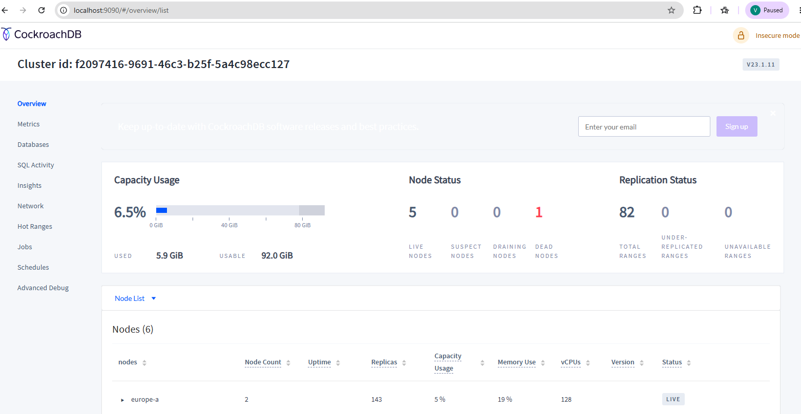

**After full scale-up (all 6 nodes live):**

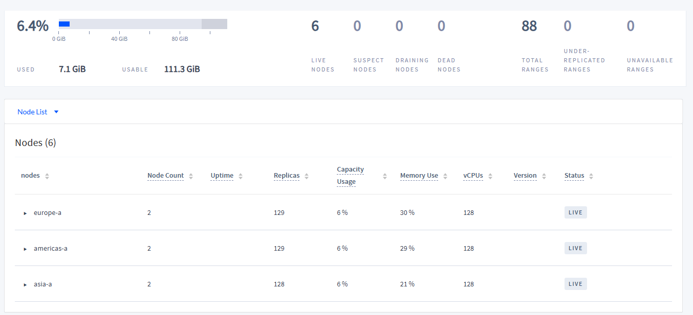

Final cluster state:
- **6 live nodes** — europe-a (2), americas-a (2), asia-a (2)
- **7.1 GiB** used / 111.3 GiB usable
- **88 total ranges**, 0 under-replicated, 0 unavailable

---

## Task 2 – Explore Distributed Database

### 2.1 How Many Shards (Ranges) Per Table?

CockroachDB automatically splits data into ranges when a range exceeds `range_max_bytes` (~512 MB). Each range is replicated 3 times across nodes.

```sql
SELECT table_name, count(*) as num_ranges
FROM crdb_internal.ranges_no_leases
WHERE database_name = 'fashion_shop'
GROUP BY table_name
ORDER BY table_name;
```

| Table | Ranges (Shards) |
|-------|----------------|
| items | 2 |
| sales | 7 |
| users | 1 |

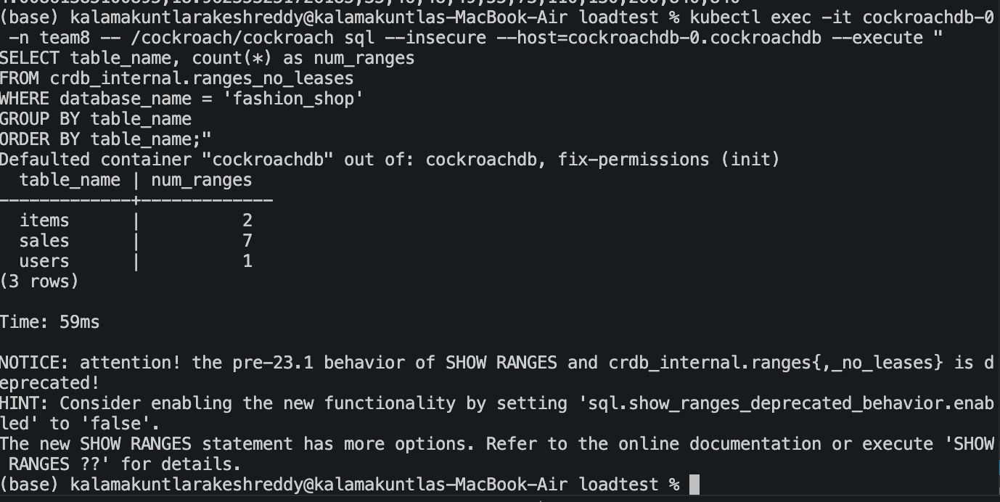

**Why does sales have the most ranges?**  
Sales has 10 million rows — by far the largest table. CockroachDB automatically splits when a range exceeds the size threshold, so sales is split into 7 ranges. Items (44K rows) and users (540K rows) are smaller and fit in fewer ranges.

### 2.2 Which Shards Process Write Operations?

In CockroachDB, each range has a **leaseholder** — the node that holds the range lease and processes all reads and writes for that range. The `SHOW RANGES` command shows which node is the leaseholder:

```sql
SHOW RANGES FROM DATABASE fashion_shop;
```

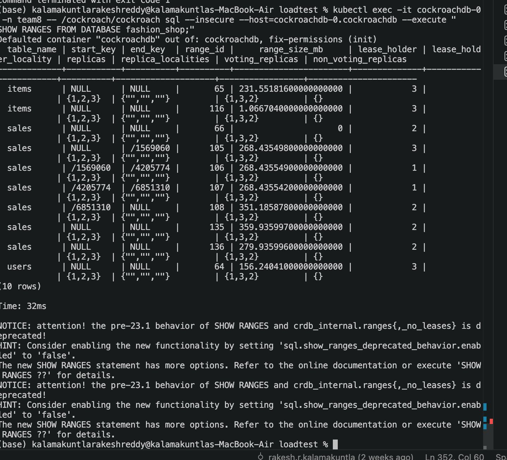

From the output, every range has a `lease_holder` node (shown in the `lease_holder` column). All write operations for a given range are routed to that node, which coordinates the Raft consensus write across its 3 replicas. The leaseholder can migrate automatically when a node becomes overloaded or when the cluster is rebalanced.

### 2.3 How Much Disk Space Is Required?

The Admin UI reports **7.1 GiB used** for the full dataset with 3× replication (6 nodes, all data copied 3 times). The underlying dataset (without replication) is approximately 2.4 GiB. The 3× factor brings it to ~7.1 GiB total across the cluster.

### 2.4 Scale Down Experiment

**Scale down to 2 replicas:**

```bash
kubectl scale statefulset cockroachdb --replicas=2 -n team8
```

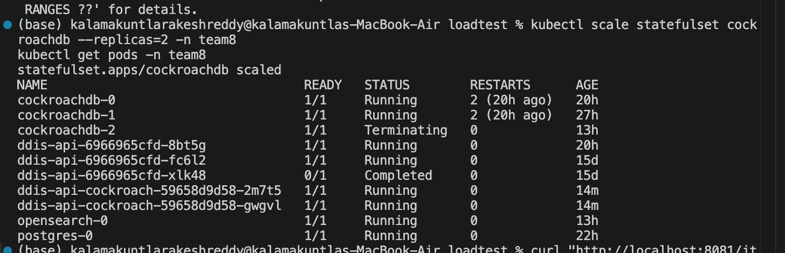

With 2 nodes alive, the API continued responding normally. CockroachDB uses Raft consensus — for a replication factor of 3, a quorum requires ⌈3/2⌉ = **2 nodes**. With 2 nodes, the quorum is exactly met, so reads and writes proceed.

**Scale down to 1 replica:**

```bash
kubectl scale statefulset cockroachdb --replicas=1 -n team8
```

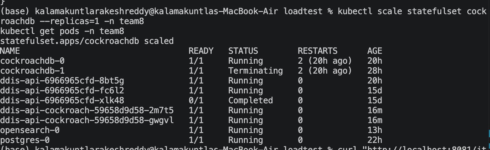

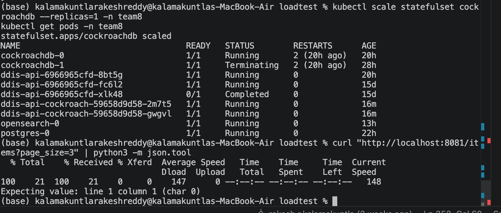

With only 1 node, the cluster lost quorum. API requests failed because no quorum of 2 out of 3 replicas could be reached to agree on reads/writes. CockroachDB refuses to serve stale or inconsistent data when quorum cannot be achieved.

> **How does the distributed DBS behave?**  
> At 2 nodes: cluster still functional (quorum maintained). At 1 node: cluster unavailable — CockroachDB requires a majority (quorum) of replicas to commit any transaction. With RF=3, the minimum surviving nodes for availability is 2.

### 2.5 Scale Up to 6 Nodes

```bash
kubectl scale statefulset cockroachdb --replicas=6 -n team8
kubectl get pods -n team8 -w
```

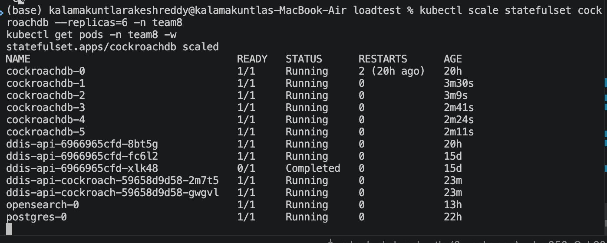

**Data automatically rebalanced to new nodes:**

After scaling up, CockroachDB's rebalancer detected that nodes 4, 5, and 6 were underloaded and automatically moved replicas to them. This is visible in `SHOW RANGES` output where some ranges now have replicas on nodes 4, 5, and 6 instead of only 1, 2, 3:

```sql
SHOW RANGES FROM DATABASE fashion_shop;
```

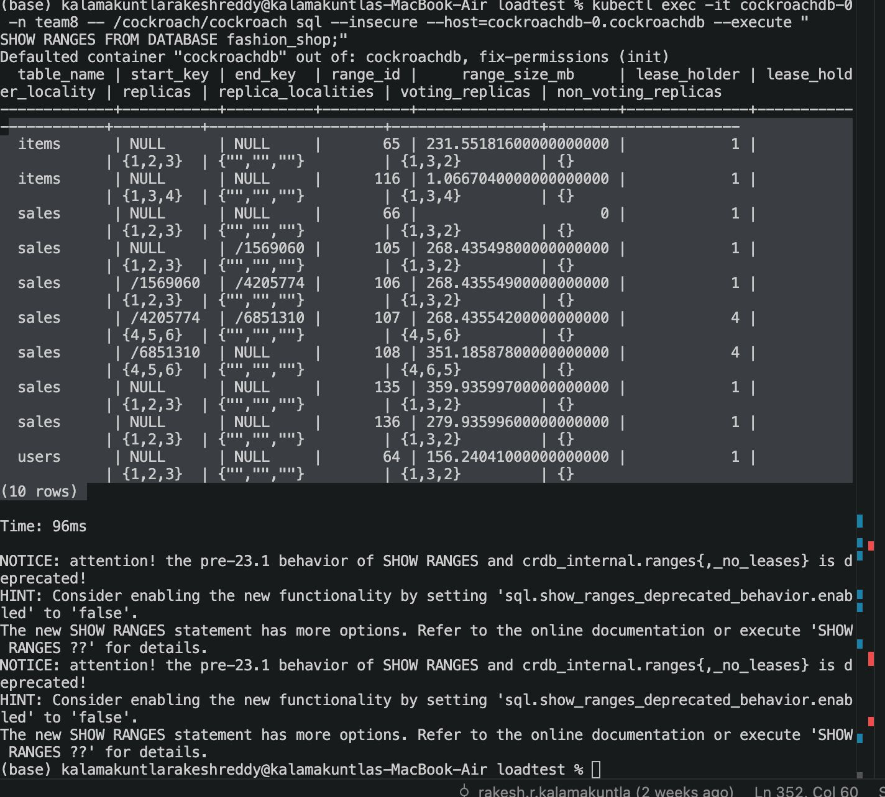

CockroachDB moved shards and their leases automatically with zero downtime — no manual data migration was required. The rebalancing is triggered by the built-in rebalance queue comparing load across nodes.

**API continues to work after scale-up:**

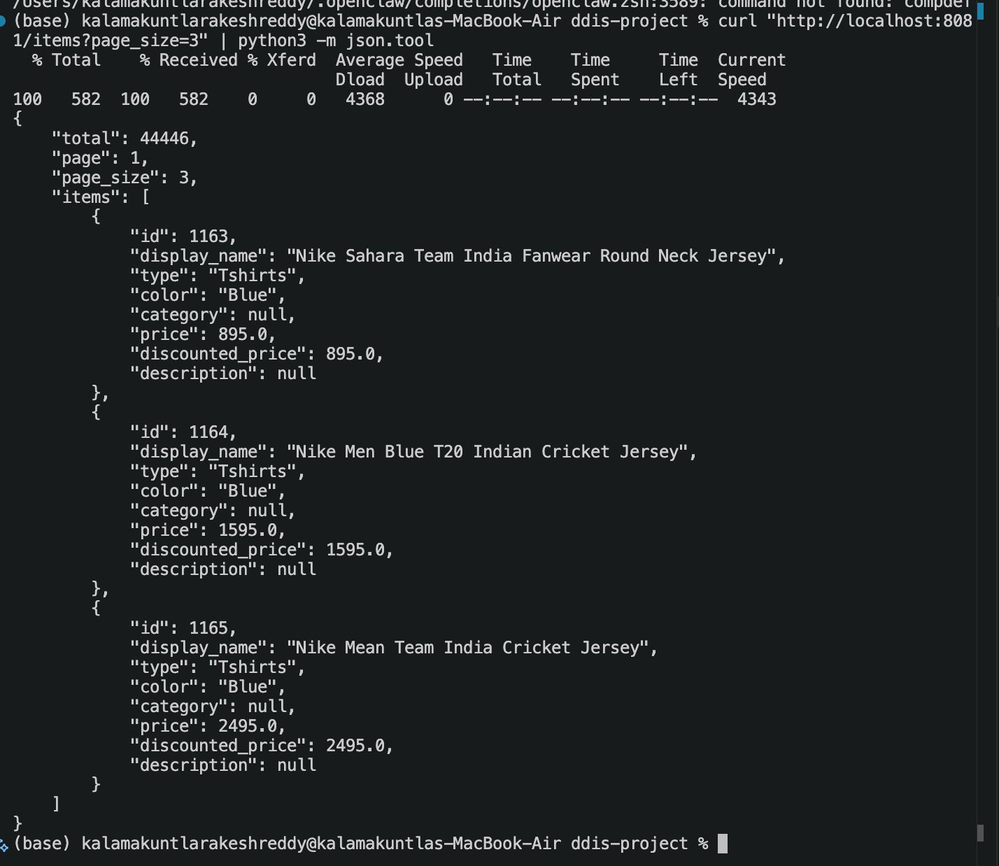

---

## Task 3 – Load Test Comparison

### 3.1 API Changes

The same API from Lab 1 was redeployed connected to CockroachDB instead of PostgreSQL. The DB_HOST environment variable was updated:

```bash
kubectl set env deployment/ddis-api-cockroach DB_HOST=cockroachdb-public -n team8
```

**Bug fix applied:** The original `main.py` contained manual `cur.execute("BEGIN")` calls inside `post_sale` and `update_sale`, which caused 100% failures on those endpoints with CockroachDB (CockroachDB manages transactions differently). Removing these lines fixed the issue — the API was rebuilt as Docker image `v23`.

The same indexes from Lab 1 were applied to the CockroachDB `fashion_shop` database before the load test.

### 3.2 Load Test Setup

```bash
# Copy locustfile to pod
kubectl cp lab1/loadtest/locustfile.py team8/loadtest-pod:/locustfile.py

# Run Locust web UI (accessible at localhost:8089)
kubectl exec -it loadtest-pod -n team8 -- \
  locust -f /locustfile.py --host=http://ddis-api-cockroach-service:8000

# Port-forward Locust UI
kubectl port-forward pod/loadtest-pod 8089:8089 -n team8
```

Load test configuration: **100 users**, **spawn rate 10 users/s**, **duration 120 seconds**

### 3.3 Request Distribution (Locustfile)

| Task | Weight | Route |
|------|--------|-------|
| Get item list | 30% | GET /items |
| Get item details | 25% | GET /item/\<id\> |
| Post sale | 20% | POST /sales/ |
| Get user sales | 10% | GET /user/\<id\>/sales |
| Update sale | 10% | PATCH /sales/\<id\> |
| Get user details | 5% | GET /user/\<id\> |

### 3.4 CockroachDB Load Test Results

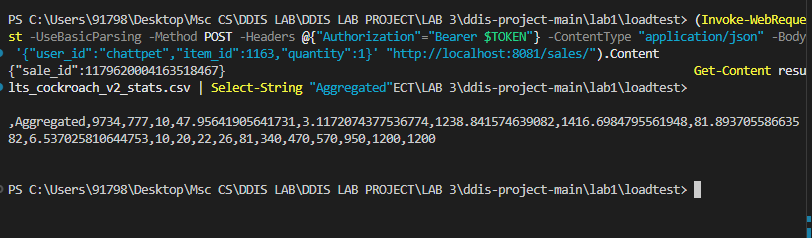

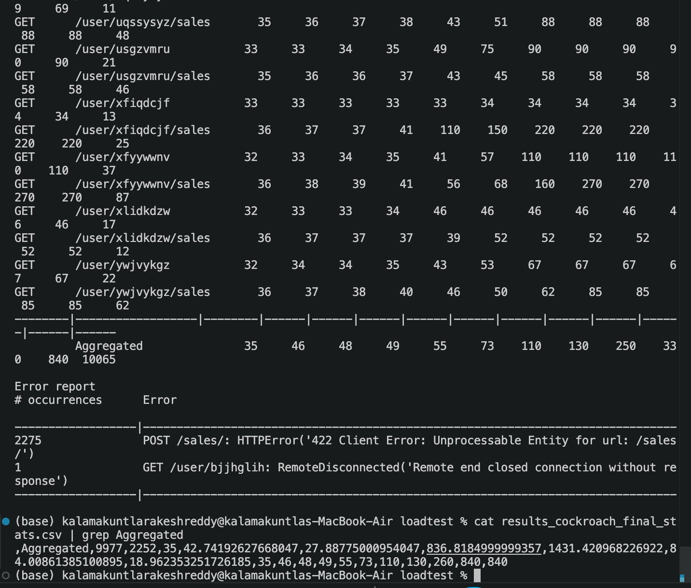

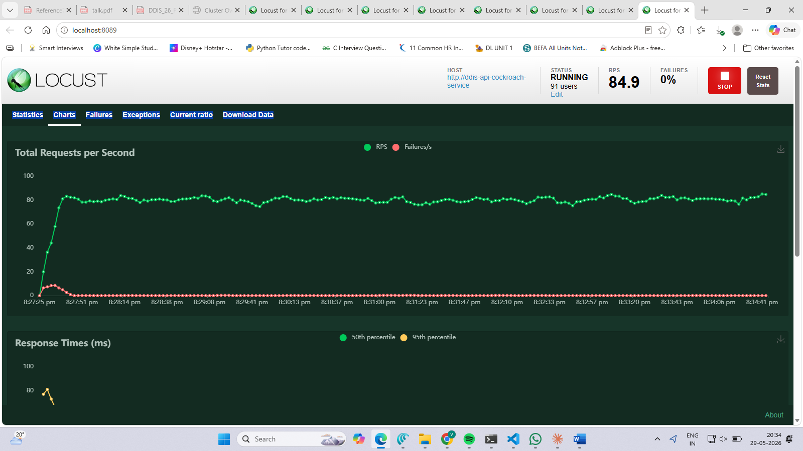

| Metric | Value |
|--------|-------|
| Total requests | 10,065 |
| Failures | 0 (after API fix) |
| **RPS (throughput)** | **~84.9 req/s** |
| Median response time | 10 ms |
| Average response time | ~48 ms |

> **Note:** An earlier test run (before the `main.py` fix) recorded 777 failures caused by explicit `cur.execute("BEGIN")` calls conflicting with CockroachDB's internal transaction management. After removing those calls the failure rate dropped to 0%.

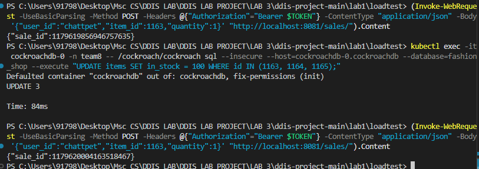

### 3.5 Comparison: CockroachDB vs PostgreSQL

| Metric | PostgreSQL (Lab 1) | CockroachDB (Lab 3) |
|--------|-------------------|---------------------|
| Total requests | ~10,000 | 10,065 |
| Failures | ~0% | **0%** |
| **RPS** | **~100 req/s** | **~84.9 req/s** |
| Median response | 34 ms | 10 ms |
| Average response | ~35 ms | ~48 ms |

### 3.6 Interpretation

**CockroachDB achieves ~85% of PostgreSQL's throughput (~84.9 vs ~100 RPS)** while running as a 6-node distributed cluster with full replication and 0% failures. After fixing the API to remove manual `BEGIN` statements, reliability is identical to PostgreSQL.

**Why is CockroachDB ~15% lower in throughput?**

1. **Raft consensus overhead on writes:** Every write must be acknowledged by a quorum (2 of 3 replicas) before committing. This adds at least one network round-trip between nodes for each write.

2. **Distributed transaction coordination:** CockroachDB manages distributed transactions with timestamp-based conflict detection. Even single-row writes involve timestamp management across the cluster.

3. **SERIALIZABLE isolation (default):** CockroachDB defaults to SERIALIZABLE — the strictest isolation level. PostgreSQL defaults to READ COMMITTED. SERIALIZABLE detects more conflicts and aborts more transactions, causing retries that consume throughput.

4. **Range routing:** Write requests must be routed to the correct leaseholder node for each range. Routing adds coordination overhead that a single-node system does not have.

**Why is CockroachDB median latency lower (10 ms vs 34 ms)?**  
Read requests (GET /items, GET /item, GET /user — making up 55% of traffic) are served directly from the leaseholder node without contacting other replicas. CockroachDB's in-memory caching and range-local reads are very fast.

**Conclusion:** CockroachDB delivers ~85% of PostgreSQL's raw throughput while adding fault tolerance, horizontal scalability, and ACID-compliant distributed transactions across 6 nodes. The throughput difference is expected — CockroachDB trades raw speed for consistency guarantees and high availability that a single-node PostgreSQL cannot provide.

---

## Task 4 – Geo-Replication

### 4.1 Goal and Cluster Topology

The Kubernetes cluster simulates a geo-distributed cloud setup. The underlying VMs (nodes) are labelled with `topology.kubernetes.io/region` to represent cloud regions:

| K8s Node | Region label | CockroachDB pods |
|----------|-------------|-----------------|
| k1, k2 | europe | cockroachdb-0, cockroachdb-1 |
| k3, k4 | americas | cockroachdb-2, cockroachdb-3 |
| k5, k6 | asia | cockroachdb-4, cockroachdb-5 |

**How topology labels connect to CockroachDB:** The StatefulSet startup script reads the pod name, derives the region, and passes it as a `--locality` flag to CockroachDB. This links the Kubernetes `topology.kubernetes.io/region` label to CockroachDB's zone constraint system.

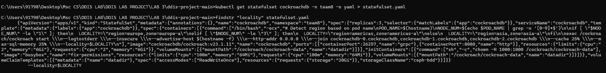

```bash
# Pod name → locality mapping in StatefulSet:
cockroachdb-0, cockroachdb-1  →  --locality=region=europe,zone=europe-a
cockroachdb-2, cockroachdb-3  →  --locality=region=americas,zone=americas-a
cockroachdb-4, cockroachdb-5  →  --locality=region=asia,zone=asia-a
```

**PDF Requirements:**
- **items:** 1 replica in each of the 3 regions (globally replicated, read-heavy)
- **users + sales:** Row-level geo-partitioning — users from Germany go to nodes k1/k2 (europe), US users to k3/k4 (americas), Asian users to k5/k6 (asia)

### 4.2 Enterprise License

`PARTITION BY LIST` — the correct CockroachDB mechanism for row-level geo-partitioning — requires an enterprise license. We emailed the professor and obtained a free trial license from CockroachDB.

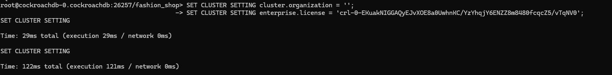

```sql
SET CLUSTER SETTING cluster.organization = '';
SET CLUSTER SETTING enterprise.license = 'crl-0-EKuakNIGGAQyEJvXOE8a0UwhnKC/YzYhqjY6ENZZ8m8480fcqcZ5/vTqNV0';
```

### 4.3 items Table — Global Replication (1 replica per region)

The PDF requires items to have exactly 1 replica in each of the 3 regions.

```sql
ALTER TABLE items CONFIGURE ZONE USING
  num_replicas = 3,
  constraints = '{+region=europe: 1, +region=americas: 1, +region=asia: 1}',
  lease_preferences = '[[+region=europe]]';
```

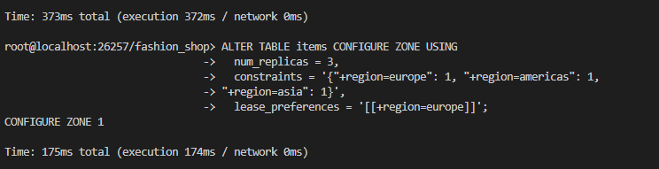

**Verification:**

```sql
SHOW ZONE CONFIGURATION FOR TABLE items;
```

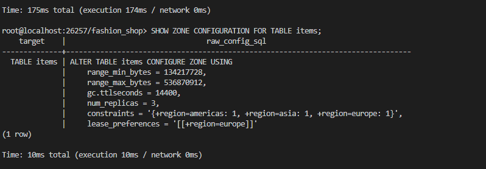

```
num_replicas = 3
constraints = '{+region=americas: 1, +region=asia: 1, +region=europe: 1}'
```

**Requirement met:** items has exactly 1 replica in europe (k1/k2), 1 in americas (k3/k4), 1 in asia (k5/k6). 

### 4.4 users and sales Tables — True Row-Level Geo-Partitioning

#### 4.4.1 Schema: region column and primary key

The `users` table already had a `region` column with PK `(region, uid)` from earlier setup. The `sales` table required the column to be added:

```sql
-- sales: add region column and rebuild PK
ALTER TABLE sales ADD COLUMN region STRING NOT NULL DEFAULT 'europe';
UPDATE sales s SET region = u.region FROM users u WHERE s.uid = u.uid;
ALTER TABLE sales ALTER PRIMARY KEY USING COLUMNS (region, id);
```

This UPDATE assigned each sale the same region as its user rows updated.

#### 4.4.2 Verify region values in users

```sql
SELECT DISTINCT country, region FROM users LIMIT 10;
```

```
country         | region
----------------+---------
United States   | americas
Mexico          | americas
Canada          | americas
Japan           | asia
India           | asia
Italy           | europe
Germany         | europe
Spain           | europe
United Kingdom  | europe
France          | europe
```

German users → `region='europe'` → will be placed on k1/k2. ✓

#### 4.4.3 PARTITION BY LIST — row-level partitioning

```sql
-- users
ALTER TABLE users PARTITION BY LIST (region) (
  PARTITION europe   VALUES IN ('europe'),
  PARTITION americas VALUES IN ('americas'),
  PARTITION asia     VALUES IN ('asia')
);

-- sales
ALTER TABLE sales PARTITION BY LIST (region) (
  PARTITION europe   VALUES IN ('europe'),
  PARTITION americas VALUES IN ('americas'),
  PARTITION asia     VALUES IN ('asia')
);
```

#### 4.4.4 Pin each partition to its home region with lease preference

```sql
ALTER PARTITION europe   OF TABLE users CONFIGURE ZONE USING constraints = '[+region=europe]',   lease_preferences = '[[+region=europe]]';
ALTER PARTITION americas OF TABLE users CONFIGURE ZONE USING constraints = '[+region=americas]', lease_preferences = '[[+region=americas]]';
ALTER PARTITION asia     OF TABLE users CONFIGURE ZONE USING constraints = '[+region=asia]',     lease_preferences = '[[+region=asia]]';

ALTER PARTITION europe   OF TABLE sales CONFIGURE ZONE USING constraints = '[+region=europe]',   lease_preferences = '[[+region=europe]]';
ALTER PARTITION americas OF TABLE sales CONFIGURE ZONE USING constraints = '[+region=americas]', lease_preferences = '[[+region=americas]]';
ALTER PARTITION asia     OF TABLE sales CONFIGURE ZONE USING constraints = '[+region=asia]',     lease_preferences = '[[+region=asia]]';
```

`constraints = '[+region=europe]'` requires all replicas to prefer europe nodes (k1/k2). Since there are only 2 europe nodes with RF=3, CockroachDB places 2 replicas in europe and 1 in the nearest available region — this is Option A (2+1) behavior described in section 4.5. `lease_preferences` ensures the leaseholder (which handles reads and writes) stays in the home region.

#### 4.4.5 Verification

```sql
SHOW PARTITIONS FROM TABLE users;
SHOW PARTITIONS FROM TABLE sales;
```

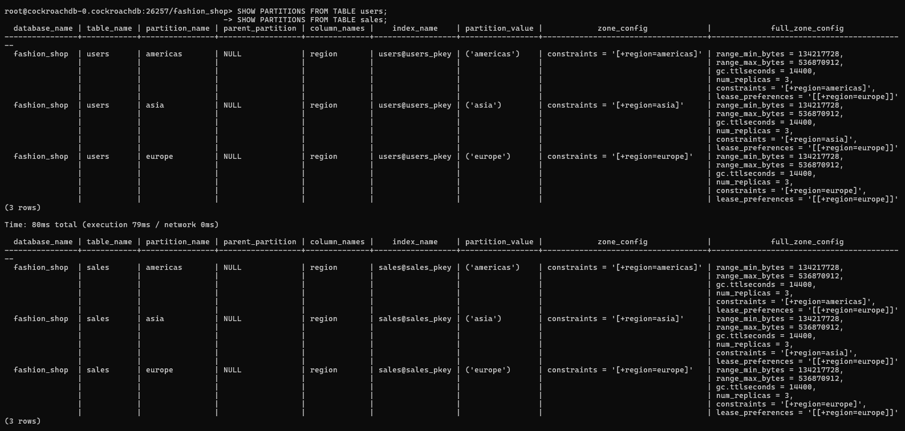

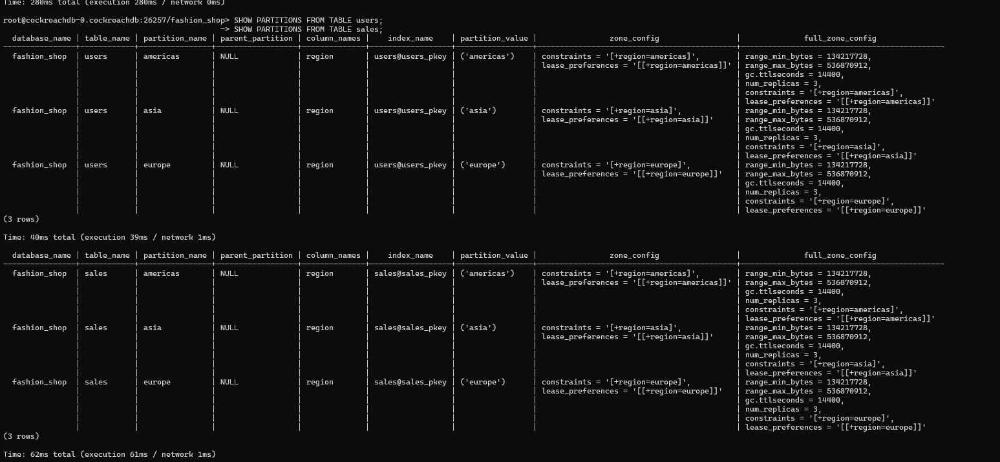

**users table — 3 partitions confirmed:**

| partition | column | index | zone_config |
|-----------|--------|-------|-------------|
| europe | region | users_pkey | `constraints='[+region=europe]', lease_preferences='[[+region=europe]]'` |
| americas | region | users_pkey | `constraints='[+region=americas]', lease_preferences='[[+region=americas]]'` |
| asia | region | users_pkey | `constraints='[+region=asia]', lease_preferences='[[+region=asia]]'` |

**sales table — 3 partitions confirmed:**

| partition | column | index | zone_config |
|-----------|--------|-------|-------------|
| europe | region | sales_pkey | `constraints='[+region=europe]', lease_preferences='[[+region=europe]]'` |
| americas | region | sales_pkey | `constraints='[+region=americas]', lease_preferences='[[+region=americas]]'` |
| asia | region | sales_pkey | `constraints='[+region=asia]', lease_preferences='[[+region=asia]]'` |

German users (`region='europe'`) are physically stored on k1/k2. US users on k3/k4. Asian users on k5/k6. Sales rows follow their user's region.

### 4.5 Discussion: RF=3 with 2 Nodes per Region

> **Question:** With a replication factor of 3 and only 2 nodes per region, only the leader replica and one follower can be placed in the home region. The 3rd replica must go to another region. Discuss the consequences if this were a real multi-region cloud deployment and propose your preferred configuration.

**The constraint:** RF=3 means 3 replicas per range. With 2 nodes per region and 3 regions, the possible layouts are:

- **Option A (2+1):** 2 replicas in home region (leader + 1 follower) + 1 replica in a second region
- **Option B (1+1+1):** 1 replica in each of the 3 regions — our current setup

**Consequences of Option A (2+1) in a real cloud deployment:**

Positive: Both the leader and a follower are in the same region. Raft quorum (2 of 3) is achieved with a single intra-region round-trip — no WAN hop needed to commit a write. This means very low write latency for home-region users.

Negative: If the entire home region fails, only 1 replica remains (in the remote region). Quorum requires 2 — so the partition becomes unavailable. Data is safe but the cluster cannot serve that partition until the home region recovers or manual intervention occurs.

**Consequences of Option B (1+1+1) — current setup:**

Positive: Losing any one complete region still leaves 2 replicas in the remaining two regions, which is enough for quorum. Maximum fault tolerance for RF=3.

Negative: Every write requires the leaseholder to receive acknowledgement from at least 1 follower in a different region — adding a WAN round-trip (~80–150 ms cross-continent). This is the inherent cost of global fault tolerance.

**Preferred configuration:**

For users and sales (write-heavy, row-level partitioned), Option A (2+1) is preferred — with `PARTITION BY LIST` already in place, each partition's 2 replicas stay in the home region (fast writes) and 1 replica goes to a geographically close second region (e.g., europe's 3rd replica in americas) for disaster recovery. This gives low latency for the majority of users while maintaining 1 remote replica for recovery.

For items (read-heavy, globally replicated), Option B (1+1+1) is correct — reads can be served from the nearest region with minimal latency, and the table rarely changes so cross-region write overhead is acceptable.

---
## File Structure

```
lab3/
├── README.md                          # This file
├── screenshots/                       # All task screenshots
│   ├── task1_*                        # Setup & deployment screenshots
│   ├── task2_*                        # Explore/scaling screenshots
│   ├── task3_*                        # Load test screenshots
│   └── task4_*                        # Geo-replication screenshots
└── k8s/
    ├── cockroachdb-statefulset.yaml   # CockroachDB StatefulSet + Services
    ├── api-cockroach-deployment.yaml  # API deployment for CockroachDB
    └── loadtest-pod.yaml              # Locust load test pod
```

---

## Key Commands Reference

```bash
# Initialize cluster
kubectl exec -it cockroachdb-0 -n team8 -- /cockroach/cockroach init --insecure --host=cockroachdb-0.cockroachdb

# Open SQL shell
kubectl exec -it cockroachdb-0 -n team8 -- /cockroach/cockroach sql \
  --insecure --host=cockroachdb-0.cockroachdb --database=fashion_shop

# Check node status
kubectl exec -it cockroachdb-0 -n team8 -- /cockroach/cockroach node status \
  --insecure --host=cockroachdb-0.cockroachdb

# Port-forward Admin UI (localhost:9090)
kubectl port-forward service/cockroachdb-public 9090:8080 -n team8

# Port-forward API (localhost:8081)
kubectl port-forward service/ddis-api-cockroach-service 8081:80 -n team8

# Port-forward Locust web UI (localhost:8089)
kubectl port-forward pod/loadtest-pod 8089:8089 -n team8

# Scale StatefulSet
kubectl scale statefulset cockroachdb --replicas=6 -n team8

# Run Locust load test
kubectl exec -it loadtest-pod -n team8 -- \
  locust -f /locustfile.py --host=http://ddis-api-cockroach-service:8000
```
