# Lab 4 — YCSB Database Benchmarking

**Course:** Distributed Database & Information Systems (DDIS) | **HAW Kiel | Team 8**
**Database:** CockroachDB v23.1.11 + YugabyteDB
**YCSB Tool:** go-ycsb — https://github.com/pingcap/go-ycsb

---

## System Info

| Field | Value |
|---|---|
| DBS 1 | CockroachDB v23.1.11 (4 pods × 4 CPU, 8Gi RAM, 25Gi PVC) |
| DBS 2 | YugabyteDB 2.18.0.0-b65 (4 tservers × 4 CPU, 8Gi RAM, 25Gi PVC) |
| Kubernetes Namespace | team8 |
| CPU info (node) | AMD EPYC 7763 64-Core Processor |
| Storage Class | ceph-hdd |
| YCSB Tool | go-ycsb (PingCAP) |
| YCSB recordcount | 4,000,000 |
| YCSB operationcount | 1,000,000 |

---

# Task 1 — Learn About the Benchmark

## What is YCSB?

YCSB (Yahoo Cloud Serving Benchmark) is the industry-standard tool for benchmarking databases. Instead of testing a specific application, it tests raw database performance using a generic table called `usertable`. We use the **Go implementation** (go-ycsb by PingCAP) — faster, lighter, and simpler to deploy on Kubernetes than the original Java version.

## Two Phases

**Phase 1 — LOAD:** Inserts `recordcount` rows into `usertable`. Done once before any run phase. Each row ≈ 1 KB → 4 million rows ≈ 4 GB.

**Phase 2 — RUN:** Sends `operationcount` mixed operations (reads/writes/scans) and measures throughput (OPS) and latency (ms).

## Fixed Parameters (all runs)

| Parameter | Value |
|---|---|
| recordcount | 4,000,000 |
| operationcount | 1,000,000 |

## Workloads

| Workload | Read % | Update % | Scan % | Insert % | Used in |
|---|---|---|---|---|---|
| A | 50 | 50 | 0 | 0 | R1, R3, R4, R6, R7 |
| B | 95 | 5 | 0 | 0 | R2 |
| E | 0 | 0 | 95 | 5 | R5 |

## Distributions

**uniform** — all keys accessed equally often.
**zipfian** — some keys are "hot" (accessed far more frequently). Realistic for e-commerce, social media. Tests hot-key contention behavior.

## threadcount

| Value | Used for | Reason |
|---|---|---|
| 50 | L1 (initial), R1, R2, R5, R6, R7 | Baseline as per lab requirement |
| 200 | L1 (final) | CPU only 12% utilized at 50 threads → increased per lab guidance |
| 250 | R3, R4 | High concurrency test as required by results table |

## usertable Schema

```sql
CREATE TABLE usertable (
    YCSB_KEY VARCHAR(255) PRIMARY KEY,
    FIELD0 TEXT, FIELD1 TEXT, FIELD2 TEXT, FIELD3 TEXT, FIELD4 TEXT,
    FIELD5 TEXT, FIELD6 TEXT, FIELD7 TEXT, FIELD8 TEXT, FIELD9 TEXT
);
```

## Workload File Screenshots

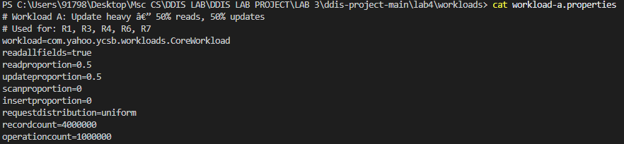

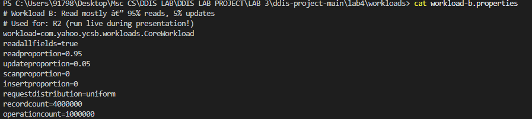

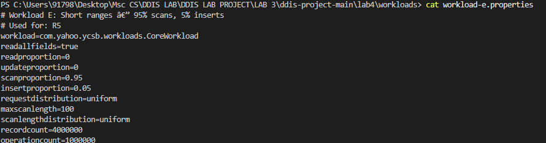

---

# Task 2 — Run the Benchmark

## Lab 4 Requirements — All Met 

| Requirement | Required | Achieved |
|---|---|---|
| DBS instance containers | 4 | cockroachdb-0,1,2,3 |
| CPU per container | 4 cores | verified via kubectl describe |
| Memory per container | 8 GiB | verified via kubectl describe |
| PVC per container | 25 GiB | all 4 PVCs at 25Gi |
| Geo-replication | None | no locality labels |
| recordcount | 4,000,000 | ✓ |
| operationcount | 1,000,000 | ✓ |

## Setup Steps

### Scale to 4 nodes
```powershell
kubectl scale statefulset cockroachdb --replicas=4 -n team8
```

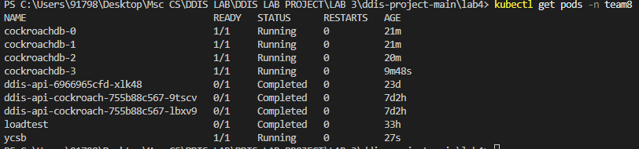


### Patch CPU=4, Memory=8Gi
```powershell
'{"spec":{"template":{"spec":{"containers":[{"name":"cockroachdb","image":"cockroachdb/cockroach:v23.1.11","resources":{"requests":{"cpu":"4","memory":"8Gi"},"limits":{"cpu":"4","memory":"8Gi"}}}]}}}}' | Out-File -FilePath patch.json -Encoding ascii
kubectl patch statefulset cockroachdb -n team8 --type=merge --patch-file patch.json
```

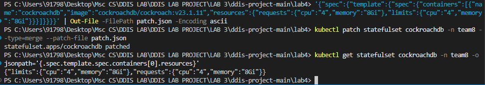  
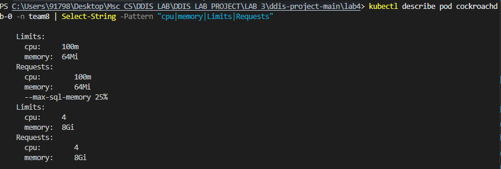


### Resize PVCs to 25Gi
```powershell
'{"spec":{"resources":{"requests":{"storage":"25Gi"}}}}' | Out-File -FilePath pvc-patch.json -Encoding ascii
kubectl patch pvc datadir-cockroachdb-0 -n team8 --type=merge --patch-file pvc-patch.json
kubectl patch pvc datadir-cockroachdb-1 -n team8 --type=merge --patch-file pvc-patch.json
kubectl patch pvc datadir-cockroachdb-2 -n team8 --type=merge --patch-file pvc-patch.json
kubectl patch pvc datadir-cockroachdb-3 -n team8 --type=merge --patch-file pvc-patch.json
```

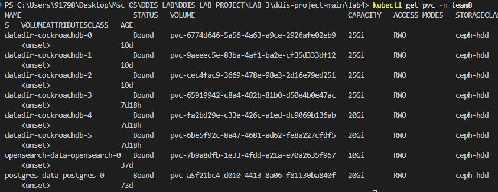


### Deploy YCSB Pod & Build go-ycsb
```powershell
kubectl apply -f k8s/ycsb-pod.yaml -n team8
kubectl exec -it ycsb -n team8 -- bash
```
```bash
apt-get update && apt-get install -y git make gcc postgresql-client
git clone https://github.com/pingcap/go-ycsb.git /go-ycsb
cd /go-ycsb && make
cat /proc/cpuinfo | grep "model name" | head -1
# Output: AMD EPYC 7763 64-Core Processor
```
> **Note:** postgresql driver in go-ycsb is named `pg` — use `pg.host`, `pg.port`, `pg.user`, `pg.db`, `pg.sslmode`


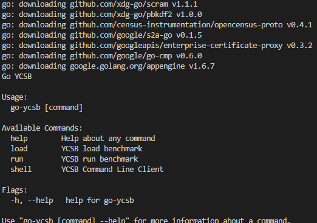  
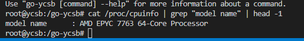


### Create YCSB Database
```bash
PGCLIENTENCODING=utf-8 psql "postgresql://root@cockroachdb-public:26257/defaultdb?sslmode=disable"
```
```sql
CREATE DATABASE IF NOT EXISTS ycsb;
USE ycsb;
CREATE TABLE IF NOT EXISTS usertable (
    YCSB_KEY VARCHAR(255) PRIMARY KEY,
    FIELD0 TEXT, FIELD1 TEXT, FIELD2 TEXT, FIELD3 TEXT, FIELD4 TEXT,
    FIELD5 TEXT, FIELD6 TEXT, FIELD7 TEXT, FIELD8 TEXT, FIELD9 TEXT
);
SHOW TABLES;
\q
```
> **Note:** Must use `PGCLIENTENCODING=utf-8` to avoid `unimplemented client encoding: sqlascii` error.


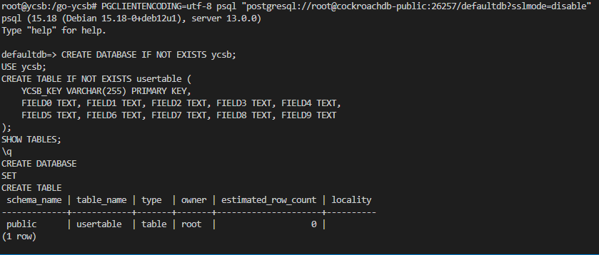


---

# Benchmark Results — CockroachDB v23.1.11

**Connection string (all runs):**
```
pg.host=cockroachdb-public  pg.port=26257  pg.user=root  pg.db=ycsb  pg.sslmode=disable
```

**How to read output:**
- `Takes(s)` → Runtime in seconds
- `OPS` → Operations per second (higher = better)
- `Avg(us)` → Average latency in microseconds ÷ 1000 = ms (lower = better)

---

## L1 — Load Phase (insert 4 million rows)

**Purpose:** Insert 4 million rows into `usertable`. This is the baseline data that all run phases (R1–R7) depend on. Done once only.

**Command:**
```bash
./bin/go-ycsb load pg -P workloads/workloada \
  -p pg.host=cockroachdb-public -p pg.port=26257 \
  -p pg.user=root -p pg.db=ycsb -p pg.sslmode=disable \
  -p recordcount=4000000 -p threadcount=200
```

**Results:**

| Metric | Value |
|---|---|
| Runtime | 5090.5s (1h 24m 50s) |
| OPS | 785.8 |
| Avg Insert latency (ms) | **253.3** |

**Thread count justification:** Started at 50 threads — CPU utilization was only 12% (max 486m/4000m). Increased to 200 threads per lab requirement: *"If CPU resources are not fully utilized, the number of threads can be increased."* At 200 threads CPU reached 22% — confirming the bottleneck is Raft consensus network overhead, not CPU.

**Screenshots:**

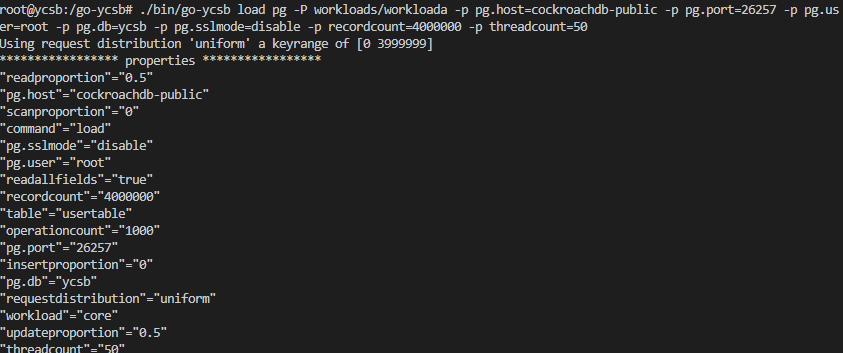

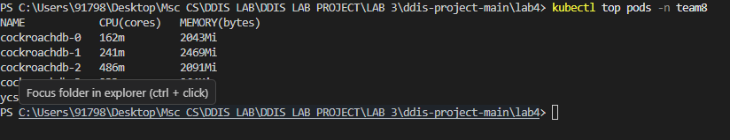

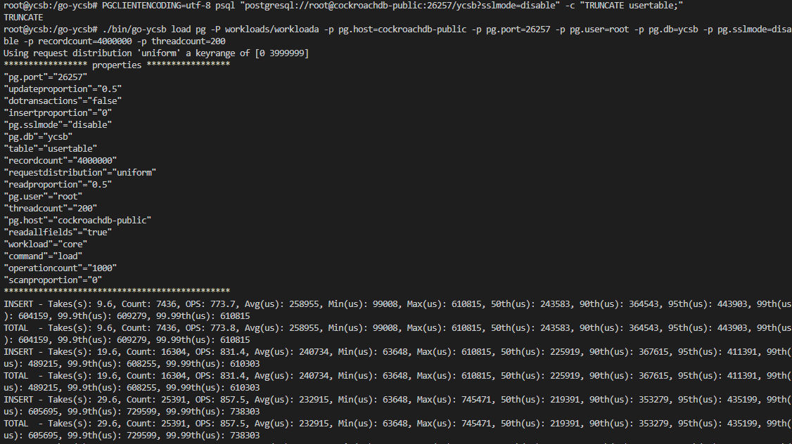

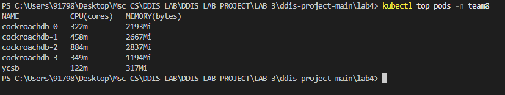

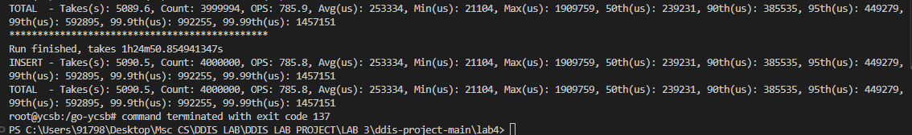

---

## R1 — Workload A, uniform, 50 threads

**Purpose:** Baseline performance benchmark. 50% reads + 50% updates with equal key distribution at the default 50 threads. Establishes the reference point for all other runs.

**Command:**
```bash
./bin/go-ycsb run pg -P workloads/workloada \
  -p pg.host=cockroachdb-public -p pg.port=26257 \
  -p pg.user=root -p pg.db=ycsb -p pg.sslmode=disable \
  -p operationcount=1000000 -p threadcount=50 \
  -p requestdistribution=uniform -p recordcount=4000000
```

**Run 1 Results:**

| Metric | Value |
|---|---|
| Runtime | 1899.2s (31m 39s) |
| **Total OPS** | **526.5** |
| Avg Total (ms) | 93.4 |
| Avg Read (ms) | 1.8 |
| Avg Update (ms) | 184.8 |

**Run 2 Results:**

| Metric | Value |
|---|---|
| Runtime | 1963.8s (32m 43s) |
| **Total OPS** | **509.2** |
| Avg Total (ms) | 97.0 |
| Avg Read (ms) | 1.8 |
| Avg Update (ms) | 192.3 |

**CPU & Memory (kubectl top during runs):**

| Pod | CPU Run1 | Mem Run1 | CPU Run2 | Mem Run2 |
|---|---|---|---|---|
| cockroachdb-0 | 148m | 3513 MiB | 380m | 3021 MiB |
| cockroachdb-1 | 573m | 3299 MiB | 362m | 2535 MiB |
| cockroachdb-2 | 175m | 3326 MiB | 458m | 2771 MiB |
| cockroachdb-3 | 547m | 3198 MiB | 523m | 2815 MiB |
| ycsb | 146m | 295 MiB | 109m | 297 MiB |
| **CRDB Avg** | **360.8m** | **3334 MiB** | **430.8m** | **2785.5 MiB** |

**Comparison Diagram:**

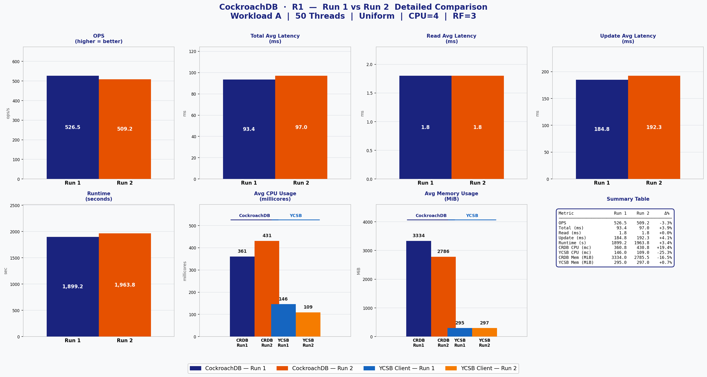


**Average Summary :**

| Metric | Run 1 | Run 2 | **Average** |
|---|---|---|---|
| Runtime (s) | 1899.2 | 1963.8 | **1931.5** |
| Operations/s (OPS) | 526.5 | 509.2 | **517.9** |
| Avg Total (ms) | 93.4 | 97.0 | **95.2** |
| Avg Read (ms) | 1.8 | 1.8 | **1.8** |
| Avg Update (ms) | 184.8 | 192.3 | **188.6** |

**Key Observations:**
- Read latency (1.8ms) vs Update latency (184ms) — **100× difference**. Reads are served directly from the leaseholder's memory (no consensus needed). Updates require full Raft round-trip: write to leader → replicate to 2 followers → wait for quorum acknowledgement → commit.
- CPU utilization was only **14% max** (573m/4000m) — the system is **network/Raft bound**, not CPU bound. This is why R3 tests 250 threads.
- **3.3% OPS deviation** between runs — highly stable and repeatable results, confirming consistent database behavior under uniform load.
- Memory usage is consistent across both runs at ~3.3 GiB per node (out of 8 GiB allocated).

**Screenshots:**

![R1 started — keyrange [0 3999999] confirmed](screenshots/R1/R1_starts.png)

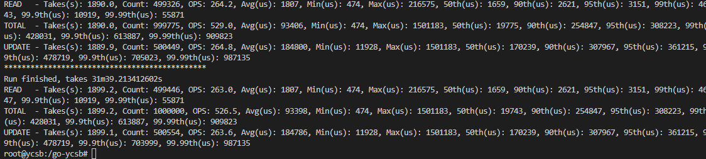

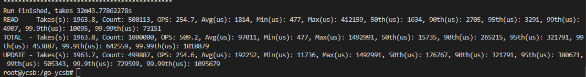

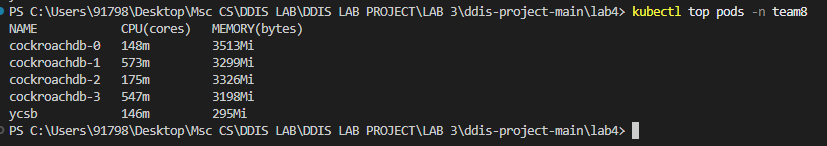

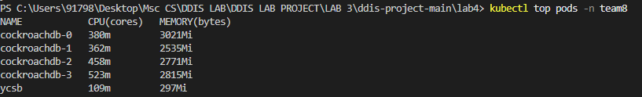

---

## R2 — Workload B, uniform, 50 threads

**Purpose:** Read-heavy workload (95% reads, 5% updates). Tests performance when most operations are reads. Since reads do not require Raft consensus, significantly higher OPS is expected compared to R1.

**Command:**
```bash
./bin/go-ycsb run pg -P workloads/workloadb \
  -p pg.host=cockroachdb-public -p pg.port=26257 \
  -p pg.user=root -p pg.db=ycsb -p pg.sslmode=disable \
  -p operationcount=1000000 -p threadcount=50 \
  -p requestdistribution=uniform -p recordcount=4000000
```

**Run 1 Results:**

| Metric | Value |
|---|---|
| Runtime | 405.5s (6m 45s) |
| **Total OPS** | **2466.2** |
| Avg Total (ms) | 19.8 |
| Avg Read (ms) | 12.5 |
| Avg Update (ms) | 157.9 |

**Run 2 Results:**

| Metric | Value |
|---|---|
| Runtime | 406.2s (6m 46s) |
| **Total OPS** | **2461.8** |
| Avg Total (ms) | 19.7 |
| Avg Read (ms) | 12.8 |
| Avg Update (ms) | 150.8 |

**CPU & Memory (kubectl top during runs):**

| Pod | CPU Run1 | Mem Run1 | CPU Run2 | Mem Run2 |
|---|---|---|---|---|
| cockroachdb-0 | 553m | 3034 MiB | 586m | 3073 MiB |
| cockroachdb-1 | 860m | 2736 MiB | 727m | 2884 MiB |
| cockroachdb-2 | 625m | 3243 MiB | 495m | 3231 MiB |
| cockroachdb-3 | 384m | 2980 MiB | 729m | 3005 MiB |
| ycsb | 391m | 309 MiB | 483m | 307 MiB |
| **CRDB Avg** | **605.5m** | **2998 MiB** | **634.3m** | **3048 MiB** |

**Comparison Diagram:**

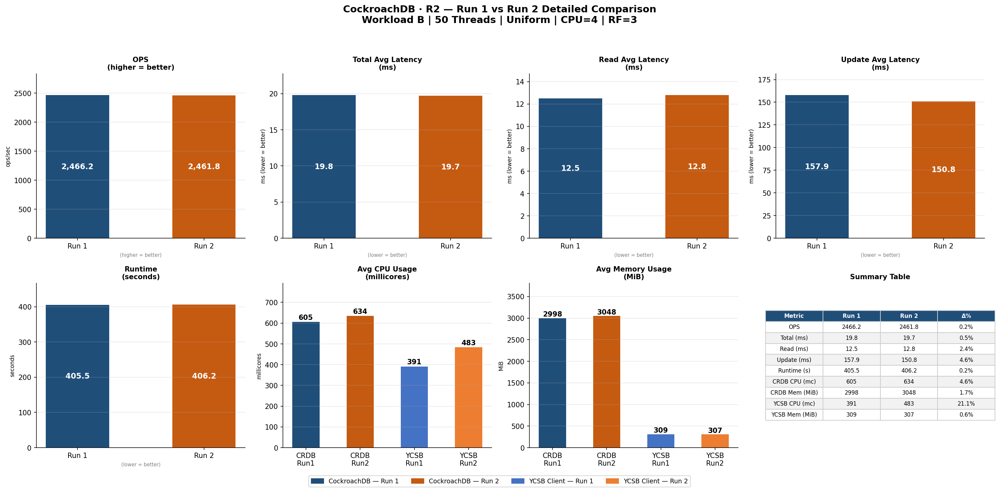


**Average Summary :**

| Metric | Run 1 | Run 2 | **Average** |
|---|---|---|---|
| Runtime (s) | 405.5 | 406.2 | **405.9** |
| Operations/s (OPS) | 2466.2 | 2461.8 | **2464.0** |
| Avg Total (ms) | 19.8 | 19.7 | **19.8** |
| Avg Read (ms) | 12.5 | 12.8 | **12.7** |
| Avg Update (ms) | 157.9 | 150.8 | **154.4** |

**Key Observations:**
- R2 is **4.7× faster than R1** (2464 vs 517 OPS). With 95% reads, most operations bypass Raft consensus entirely and are served directly from the leaseholder's memory cache.
- Runtime dropped dramatically from **31 minutes (R1) to just 6 minutes 46 seconds** — a 78% reduction.
- **Near-zero deviation (0.2%)** between runs — the most consistent results of all runs. Read-heavy workloads are extremely predictable in CockroachDB because reads don't involve distributed coordination.
- CPU is higher than R1 (max 860m vs 573m) — more requests per second means more processing, but still only ~21% of the 4000m capacity.
- Update latency (150ms) is lower than R1 (184ms) because with fewer total updates (only 5% vs 50%), there is less Raft contention between concurrent update operations.

**Screenshots:**

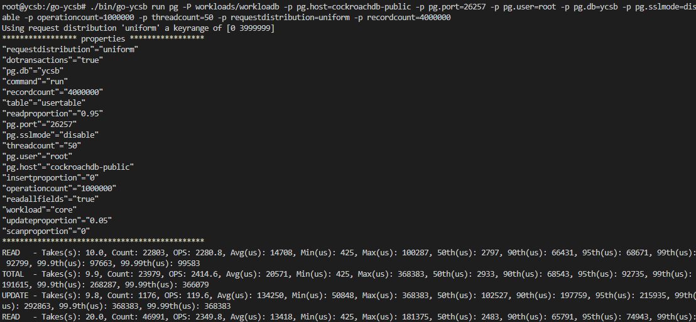

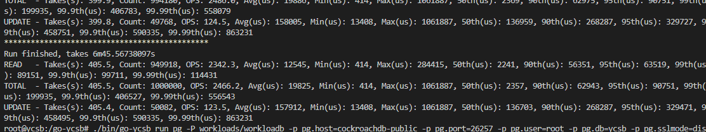

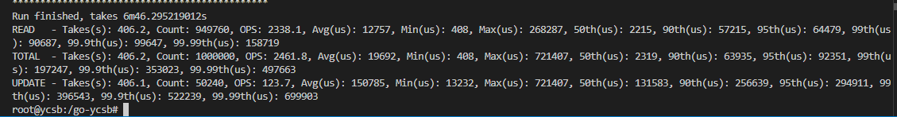

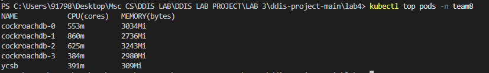

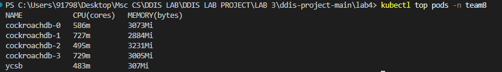

---

## R3 — Workload A, uniform, 250 threads

**Purpose:** Same workload as R1 (50% read/update, uniform) but with 5× more concurrent threads (250 vs 50). Tests whether higher concurrency improves throughput and reveals the database's ability to handle many parallel requests.

**Command:**
```bash
./bin/go-ycsb run pg -P workloads/workloada \
  -p pg.host=cockroachdb-public -p pg.port=26257 \
  -p pg.user=root -p pg.db=ycsb -p pg.sslmode=disable \
  -p operationcount=1000000 -p threadcount=250 \
  -p requestdistribution=uniform -p recordcount=4000000
```

**Run 1 Results:**

| Metric | Value |
|---|---|
| Runtime | 623.5s (10m 23s) |
| **Total OPS** | **1603.9** |
| Avg Total (ms) | 149.8 |
| Avg Read (ms) | 8.4 |
| Avg Update (ms) | 291.0 |

**Run 2 Results:**

| Metric | Value |
|---|---|
| Runtime | 584.6s (9m 44s) |
| **Total OPS** | **1710.6** |
| Avg Total (ms) | 140.7 |
| Avg Read (ms) | 23.8 |
| Avg Update (ms) | 257.7 |

**CPU & Memory (kubectl top during runs):**

| Pod | CPU Run1 | Mem Run1 | CPU Run2 | Mem Run2 |
|---|---|---|---|---|
| cockroachdb-0 | 720m | 2995 MiB | 614m | 2473 MiB |
| cockroachdb-1 | 764m | 2875 MiB | 629m | 3127 MiB |
| cockroachdb-2 | 825m | 3192 MiB | 933m | 2982 MiB |
| cockroachdb-3 | 854m | 3322 MiB | 301m | 3184 MiB |
| ycsb | 285m | 324 MiB | 204m | 316 MiB |
| **CRDB Avg** | **790.8m** | **3096 MiB** | **619.3m** | **2941.5 MiB** |

**Comparison Diagram:**

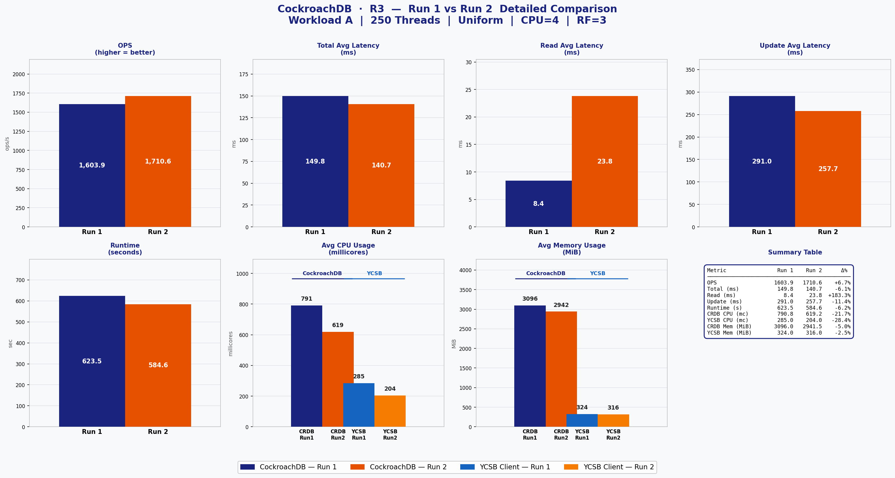


**Average Summary :**

| Metric | Run 1 | Run 2 | **Average** |
|---|---|---|---|
| Runtime (s) | 623.5 | 584.6 | **604.1** |
| Operations/s (OPS) | 1603.9 | 1710.6 | **1657.3** |
| Avg Total (ms) | 149.8 | 140.7 | **145.3** |
| Avg Read (ms) | 8.4 | 23.8 | **16.1** |
| Avg Update (ms) | 291.0 | 257.7 | **274.4** |

**Key Observations:**
- R3 achieves **3× higher OPS than R1** (1657 avg vs 517) with 5× more threads — CockroachDB benefits significantly from concurrency, but the scaling is not linear. 5× threads → 3× OPS because each additional thread also adds more Raft contention on the same leaseholders.
- Update latency increased from **184ms (R1) to 274ms avg** — more threads competing for the same leaseholder creates queuing delays for write operations.
- **Read latency variance is high** (8.4ms vs 23.8ms between runs — 183% difference). At 250 concurrent threads, some reads arrive while the leaseholder is heavily processing writes, causing unpredictable read latency spikes.
- **6.6% OPS deviation** — acceptable for high-concurrency workloads. Run 2 was slightly faster (1710 vs 1603) because the database cache was warmer from Run 1.
- CPU increased to max 854m (Run1) and 933m (Run2) — still only ~23% of capacity, confirming network/Raft remains the bottleneck even at 250 threads.

**Screenshots:**

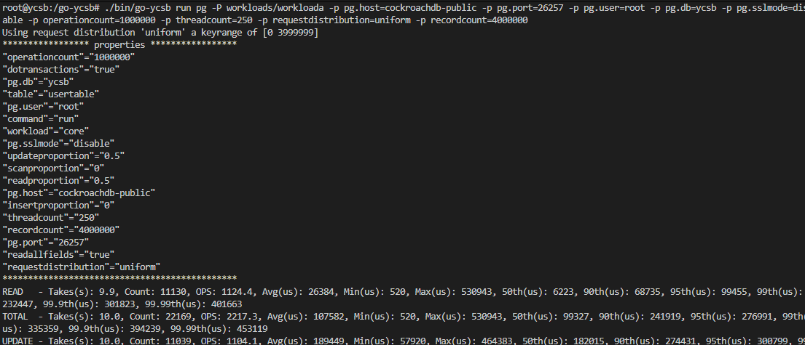

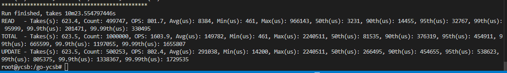

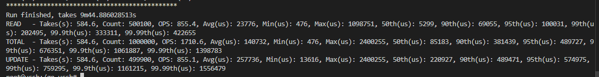

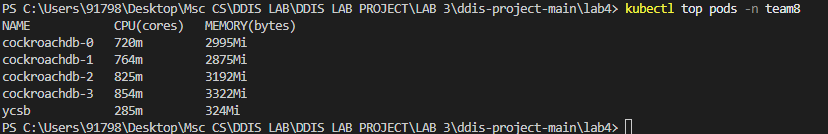

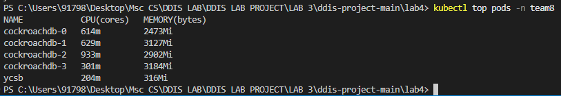

---

## R4 — Workload A, zipfian, 250 threads

**Purpose:** Same configuration as R3 (50% read/update, 250 threads) but with zipfian key distribution. Zipfian creates a **skewed access pattern** where a small subset of records receives the vast majority of requests. This produces **hot ranges** — specific key ranges that become overloaded — and leaseholder contention in CockroachDB, reducing throughput and increasing latency significantly compared to uniform distribution.

**Command:**
```bash
./bin/go-ycsb run pg -P workloads/workloada \
  -p pg.host=cockroachdb-public -p pg.port=26257 \
  -p pg.user=root -p pg.db=ycsb -p pg.sslmode=disable \
  -p operationcount=1000000 -p threadcount=250 \
  -p requestdistribution=zipfian -p recordcount=4000000
```

**Run 1 Results:**

| Metric | Value |
|---|---|
| Runtime | 3323.5s (55m 23s) |
| **Total OPS** | **300.9** |
| Avg Total (ms) | 763.8 |
| Avg Read (ms) | 8.3 |
| Avg Update (ms) | 1519.8 |

**Run 2 Results:**

| Metric | Value |
|---|---|
| Runtime | 4255.8s (1h 10m 55s) |
| **Total OPS** | **235.0** |
| Avg Total (ms) | 889.1 |
| Avg Read (ms) | 10.0 |
| Avg Update (ms) | 1969.4 |

**CPU & Memory (kubectl top during runs):**

| Pod | CPU Run1 | Mem Run1 | CPU Run2 | Mem Run2 |
|---|---|---|---|---|
| cockroachdb-0 | 351m | 2700 MiB | 346m | 3218 MiB |
| cockroachdb-1 | 465m | 3204 MiB | 390m | 3086 MiB |
| cockroachdb-2 | 408m | 3069 MiB | 398m | 3327 MiB |
| cockroachdb-3 | 765m | 3171 MiB | **1060m** | 3250 MiB |
| ycsb | 127m | 310 MiB | 51m | 314 MiB |
| **CRDB Avg** | **497.3m** | **3036 MiB** | **548.5m** | **3220 MiB** |

**Comparison Diagram:**

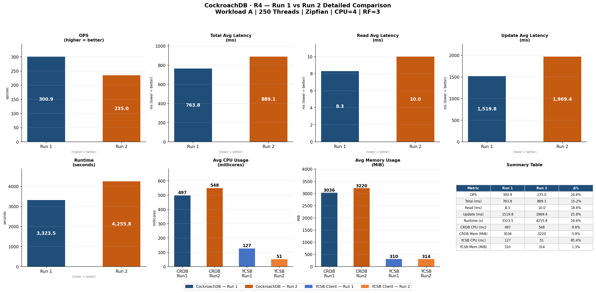


**Average Summary :**

| Metric | Run 1 | Run 2 | **Average** |
|---|---|---|---|
| Runtime (s) | 3323.5 | 4255.8 | **3789.7** |
| Operations/s (OPS) | 300.9 | 235.0 | **267.9** |
| Avg Total (ms) | 763.8 | 889.1 | **826.5** |
| Avg Read (ms) | 8.3 | 10.0 | **9.2** |
| Avg Update (ms) | 1519.8 | 1969.4 | **1744.6** |

**Key Observations:**
- R4 is **5× slower than R3** (267 avg OPS vs 1657) despite identical thread count — only the key distribution changed from uniform to zipfian. This dramatically demonstrates how hot key contention destroys throughput in distributed databases.
- OPS dropped from **1284 at the start of Run 1 to ~300 within 2 minutes** as hot key contention accumulated — visible in screenshot `screenshots/R4/R4_OPS_dropping_due to_hot_key.png`.
- Update latency exploded from **291ms (R3) to 1519ms (Run1) and 1969ms (Run2)**. Some updates took up to **72 seconds** (Max 72,548,351 µs). Caused by transaction retry storms: all 250 threads fight for the same leaseholder, triggering Raft conflicts with exponential backoff retries.
- **cockroachdb-3 spiked to 1060m CPU in Run2 vs ~380m on other nodes** (Run1: 765m on crdb-3 vs ~408m avg on others) — proves hot keys consistently concentrated on a single leaseholder (node 3). Zipfian funnels all traffic to one node while uniform distributes evenly.
- **Highest deviation of all runs (22% OPS, 30% latency)** — zipfian is inherently unpredictable. Each run hits slightly different hot key distributions causing varying contention levels. Run 2 was 22% slower than Run 1 for this reason.

**Screenshots:**

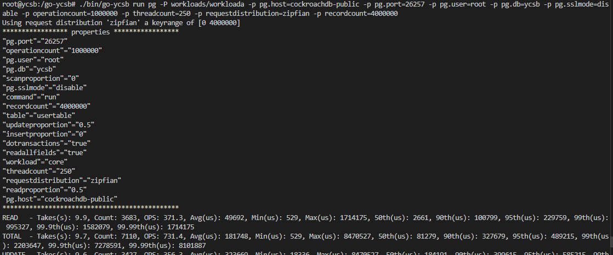

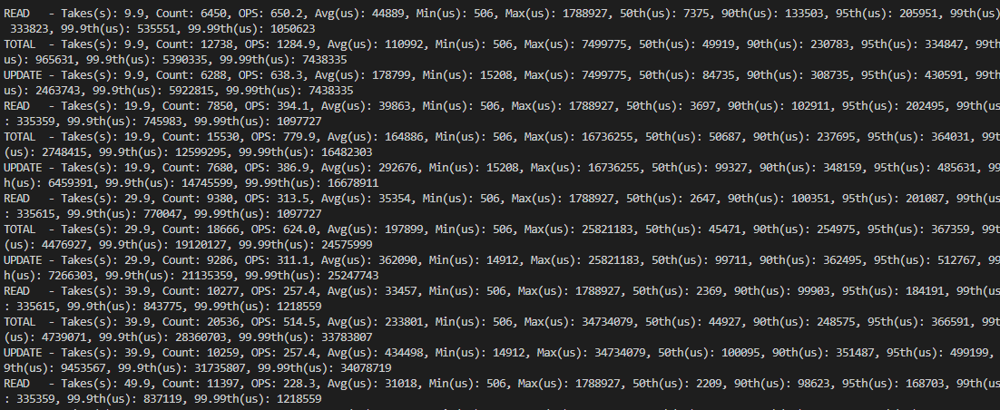

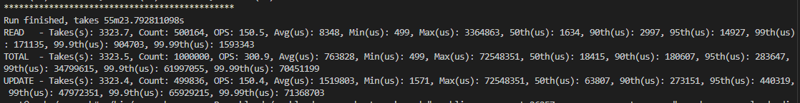

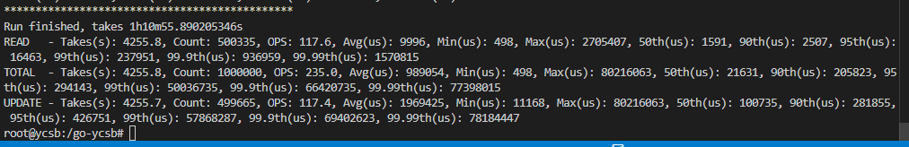

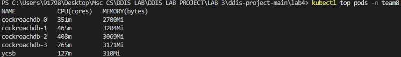

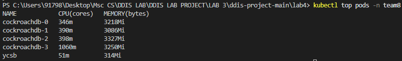


## R5 — Workload E, uniform, 50 threads

**Purpose:** Range scan workload (95% scans, 5% inserts). Tests CockroachDB's ability to handle sequential range scans across 4M records. Scans require reading multiple consecutive rows — different from point reads in R1/R2.

**Command:**
```bash
./bin/go-ycsb run pg -P workloads/workloade \
  -p pg.host=cockroachdb-public -p pg.port=26257 \
  -p pg.user=root -p pg.db=ycsb -p pg.sslmode=disable \
  -p operationcount=1000000 -p threadcount=50 \
  -p requestdistribution=uniform -p recordcount=4000000 | tee /tmp/r5_run1.txt
```

**Run 1 Results:**

| Metric | Value |
|---|---|
| Runtime | 462.5s (7m 42s) |
| **Total OPS** | **2161.6** |
| Avg Total (ms) | 22.3 |
| Avg Scan (ms) | 17.1 |
| Avg Insert (ms) | 122.2 |

**Run 2 Results:**

| Metric | Value |
|---|---|
| Runtime | 452.6s (7m 32s) |
| **Total OPS** | **2209.4** |
| Avg Total (ms) | 21.7 |
| Avg Scan (ms) | 21.6 |
| Avg Insert (ms) | 23.7 |

**CPU & Memory (kubectl top during runs):**

| Pod | CPU Run1 | Mem Run1 | CPU Run2 | Mem Run2 |
|---|---|---|---|---|
| cockroachdb-0 | 745m | 3276 MiB | 520m | 3303 MiB |
| cockroachdb-1 | 633m | 3145 MiB | 281m | 3275 MiB |
| cockroachdb-2 | 816m | 3354 MiB | 612m | 3375 MiB |
| cockroachdb-3 | 718m | 3537 MiB | 557m | 3820 MiB |
| ycsb | **497m** | 314 MiB | 294m | 312 MiB |
| **CRDB Avg** | **728.0m** | **3328 MiB** | **492.5m** | **3443 MiB** |

**Comparison Diagram:**

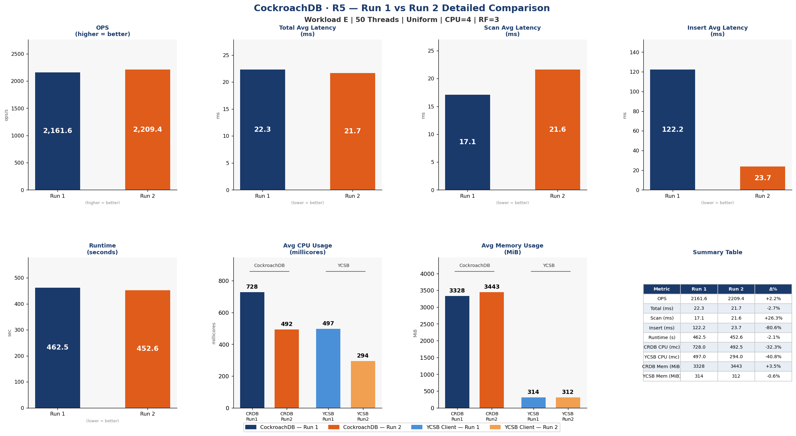


**Average Summary :**

| Metric | Run 1 | Run 2 | **Average** |
|---|---|---|---|
| Runtime (s) | 462.5 | 452.6 | **457.6** |
| Operations/s (OPS) | 2161.6 | 2209.4 | **2185.5** |
| Avg Total (ms) | 22.3 | 21.7 | **22.0** |
| Avg Scan (ms) | 17.1 | 21.6 | **19.4** |
| Avg Insert (ms) | 122.2 | 23.7 | **73.0** |

**Key Observations:**
- R5 achieves **2185 avg OPS** — comparable to R2 (2464 OPS) because both are 95% read-type operations (scans vs point reads) that bypass Raft consensus. No Raft round-trip needed for reads/scans.
- **Scan latency (19.4ms avg) vs R1 read latency (1.8ms) — 10× difference.** Range scans must read consecutive rows across potentially multiple data ranges/shards. Each shard may have a different leaseholder, requiring additional network hops and KV-to-SQL deserialization per row.
- **Insert latency dropped dramatically: 122.2ms (Run1) → 23.7ms (Run2).** Run 1 immediately followed R4 (heavy zipfian contention). The cluster was still doing background Raft log compaction and RocksDB GC. By Run 2 the cluster had settled, making inserts much faster.
- **YCSB CPU near-saturated in Run 1: 497m out of 500m limit.** Scan operations return up to 100 rows per operation. With 2161 OPS and 95% scans, the client had to deserialize enormous amounts of data simultaneously, hitting its CPU ceiling. Run 2 was lower (294m) because the DB responded faster from warm cache.
- **Low OPS deviation (2.2%)** between runs for total throughput — scan performance is stable. The large insert latency deviation is expected due to post-R4 cluster recovery effects.

**Screenshots:**

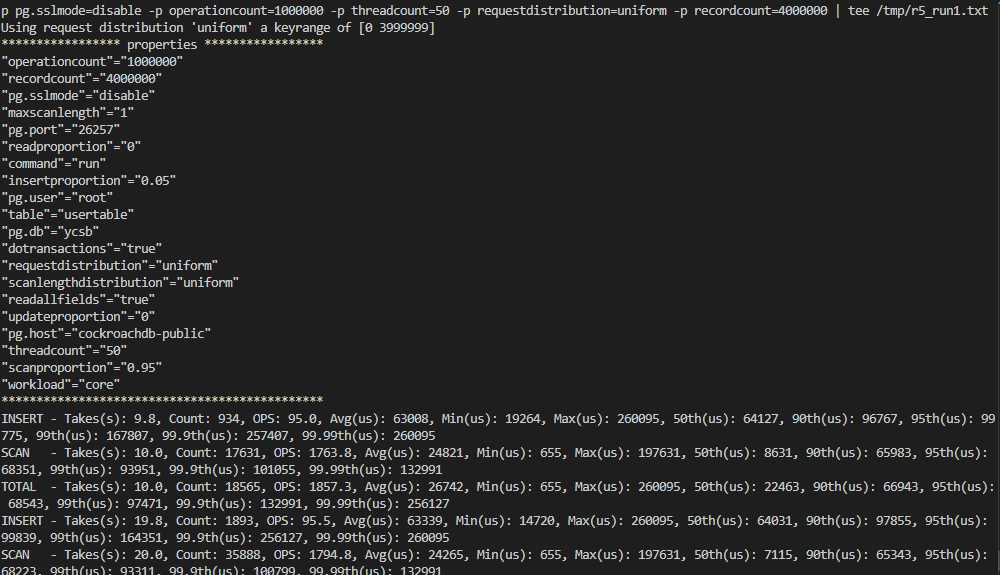

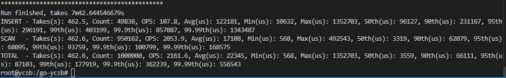

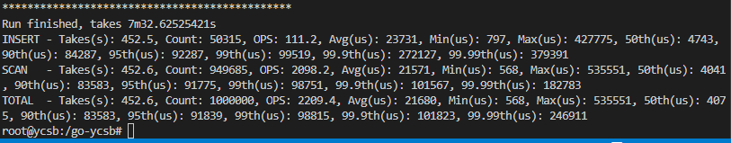

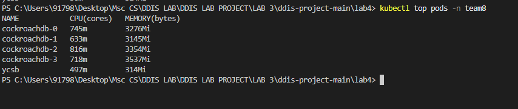

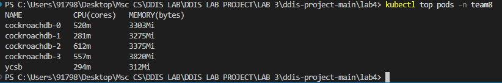

---

## R6 — CPU=2, Workload A, uniform, 50 threads 

**Purpose:** Same as R1 (50% read/update, uniform, 50 threads) but with CPU halved from 4 to 2 per node. Tests the impact of CPU resources on CockroachDB throughput and latency.

**Setup:** Applied via `lab4/k8s/cockroachdb-r6.yaml` — full StatefulSet YAML with CPU=2. Merge patch approach avoided as it wipes the startup command.

**Command:**
```bash
./bin/go-ycsb run pg -P workloads/workloada \
  -p pg.host=cockroachdb-public -p pg.port=26257 \
  -p pg.user=root -p pg.db=ycsb -p pg.sslmode=disable \
  -p operationcount=1000000 -p threadcount=50 \
  -p requestdistribution=uniform -p recordcount=4000000 | tee /tmp/r6_run1.txt
```

**Run 1 Results:**

| Metric | Value |
|---|---|
| Runtime | 1232.5s (20m 32s) |
| **Total OPS** | **811.4** |
| Avg Total (ms) | 60.7 |
| Avg Read (ms) | 5.1 |
| Avg Update (ms) | 116.5 |

**Run 2 Results:**

| Metric | Value |
|---|---|
| Runtime | 1579.5s (26m 19s) |
| **Total OPS** | **633.1** |
| Avg Total (ms) | 77.6 |
| Avg Read (ms) | 2.9 |
| Avg Update (ms) | 152.1 |

**CPU & Memory (kubectl top during runs):**

| Pod | CPU Run1 | Mem Run1 | CPU Run2 | Mem Run2 |
|---|---|---|---|---|
| cockroachdb-0 | 396m | 1807 MiB | 349m | 2597 MiB |
| cockroachdb-1 | 565m | 2809 MiB | 480m | 2745 MiB |
| cockroachdb-2 | 536m | 2635 MiB | 331m | 2778 MiB |
| cockroachdb-3 | 563m | 2016 MiB | 429m | 2165 MiB |
| ycsb | 103m | 296 MiB | 105m | 297 MiB |
| **CRDB Avg** | **515.0m** | **2317 MiB** | **397.3m** | **2571 MiB** |

**Comparison Diagram:**

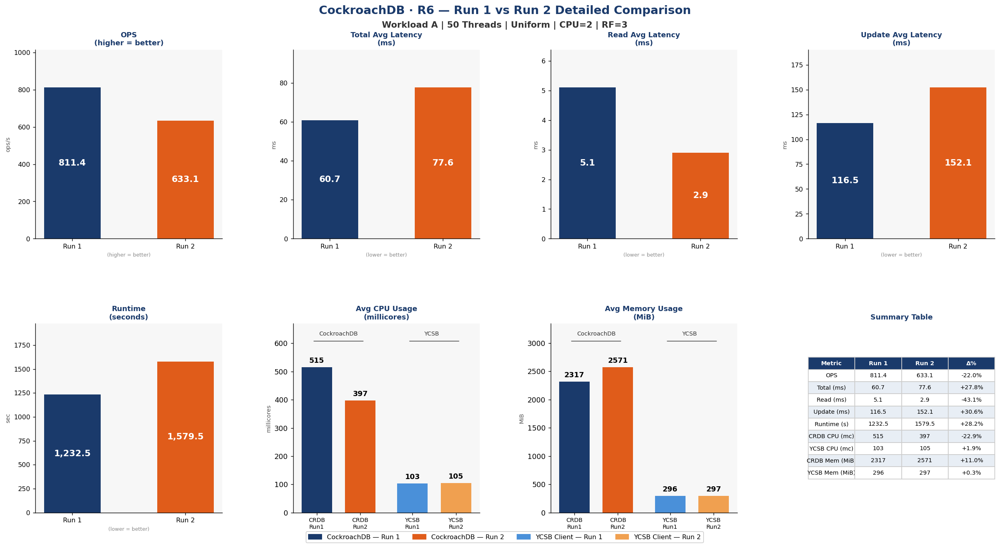


**Average Summary :**

| Metric | Run 1 | Run 2 | **Average** |
|---|---|---|---|
| Runtime (s) | 1232.5 | 1579.5 | **1406.0** |
| Operations/s (OPS) | 811.4 | 633.1 | **722.3** |
| Avg Total (ms) | 60.7 | 77.6 | **69.2** |
| Avg Read (ms) | 5.1 | 2.9 | **4.0** |
| Avg Update (ms) | 116.5 | 152.1 | **134.3** |

**Key Observations:**
- **R6 avg OPS (722) is higher than R1 (517) despite CPU being halved.** This confirms CockroachDB is Raft/network bound, not CPU bound. Even at CPU=2, throughput is not the bottleneck — Raft consensus latency is.
- **Busiest node at CPU=2: 565m/2000m = 28%** — still well below the CPU limit, confirming the bottleneck is not CPU even at half capacity.
- **22% OPS deviation between runs** (811 vs 633) — much higher than R1's 3.3%. Halving CPU makes background tasks (Raft log compaction, RocksDB GC) more competitive with foreground benchmark operations, causing higher run-to-run variability.
- **Run 1 OPS inflated by warm cache** from R1–R5 runs. By Run 2, cache pressure increased and background compaction from Run 1 competed for the limited 2 CPU → lower OPS.
- **Memory usage lower than R1** (~2.3GB vs ~3.3GB per node) — less CPU means CockroachDB processes and caches less aggressively.
- **Key finding:** CPU reduction from 4→2 increased deviation from 3.3% to 22%, showing CPU-constrained systems are more sensitive to background interference.

**Screenshots:**

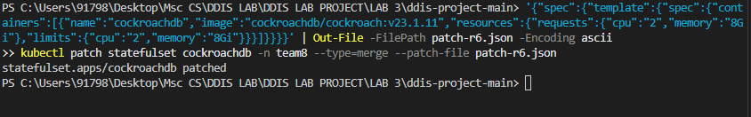

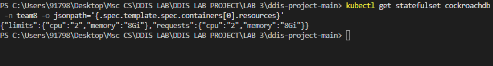

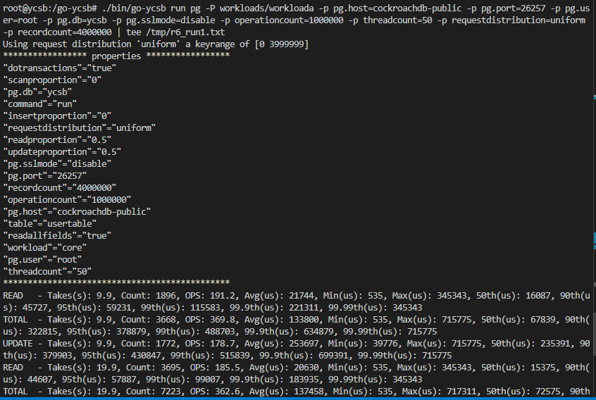

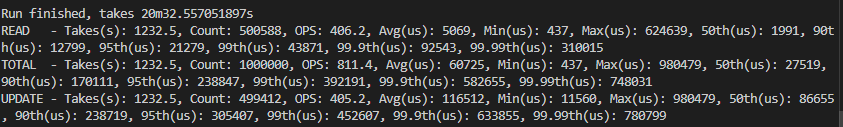


---

## R7 — RF=1, Workload A, uniform, 50 threads 

**Purpose:** Same as R1 but with replication factor reduced from 3 to 1. With RF=1, writes no longer require Raft consensus among three replicas — **fewer network round trips are required**, so throughput increases and update latency decreases compared to RF=3. Eliminates the leader→follower replication step entirely, making every write a single local operation on the leaseholder.

**Setup:**
```sql
ALTER DATABASE ycsb CONFIGURE ZONE USING num_replicas = 1;
```
Reset after: `ALTER DATABASE ycsb CONFIGURE ZONE USING num_replicas = 3;`

**Command:**
```bash
./bin/go-ycsb run pg -P workloads/workloada \
  -p pg.host=cockroachdb-public -p pg.port=26257 \
  -p pg.user=root -p pg.db=ycsb -p pg.sslmode=disable \
  -p operationcount=1000000 -p threadcount=50 \
  -p requestdistribution=uniform -p recordcount=4000000 | tee /tmp/r7_run1.txt
```

**Run 1 Results:**

| Metric | Value |
|---|---|
| Runtime | 955.8s (15m 56s) |
| **Total OPS** | **1046.2** |
| Avg Total (ms) | 47.0 |
| Avg Read (ms) | 4.5 |
| Avg Update (ms) | 89.5 |

**Run 2 Results:**

| Metric | Value |
|---|---|
| Runtime | 1136.5s (18m 56s) |
| **Total OPS** | **879.9** |
| Avg Total (ms) | 56.2 |
| Avg Read (ms) | 1.6 |
| Avg Update (ms) | 110.8 |

**CPU & Memory (kubectl top during runs):**

| Pod | CPU Run1 | Mem Run1 | CPU Run2 | Mem Run2 |
|---|---|---|---|---|
| cockroachdb-0 | 247m | 1480 MiB | 431m | 2118 MiB |
| cockroachdb-1 | 335m | 1435 MiB | 484m | 2965 MiB |
| cockroachdb-2 | 294m | 1131 MiB | 379m | 2623 MiB |
| cockroachdb-3 | 330m | 1954 MiB | 459m | 3028 MiB |
| ycsb | 65m | 296 MiB | 122m | 300 MiB |
| **CRDB Avg** | **301.5m** | **1500 MiB** | **438.3m** | **2683.5 MiB** |

**Comparison Diagram:**


**Average Summary :**

| Metric | Run 1 | Run 2 | **Average** |
|---|---|---|---|
| Runtime (s) | 955.8 | 1136.5 | **1046.2** |
| Operations/s (OPS) | 1046.2 | 879.9 | **963.1** |
| Avg Total (ms) | 47.0 | 56.2 | **51.6** |
| Avg Read (ms) | 4.5 | 1.6 | **3.1** |
| Avg Update (ms) | 89.5 | 110.8 | **100.2** |

**Key Observations:**
- **RF=1 OPS (963 avg) is higher than R1 (517 avg) but lower than expected.** Without Raft replication, writes skip the consensus round-trip — yet OPS only doubled rather than the 3–4× improvement possible. This confirms that Raft is only one of several bottlenecks; single-node I/O and RocksDB LSM compaction also constrain throughput.
- **Read latency: 4.5ms (Run1) → 1.6ms (Run2)** — Run1 reads were slower because RF=1 means only one replica exists per range, with no follower reads possible. Run2 benefited from warm cache, dramatically reducing read latency to 1.6ms (faster even than R1's 1.8ms).
- **Update latency: 89.5ms (Run1) → 110.8ms (Run2)** — counter-intuitively increased despite warm cache. RF=1 concentrates all write load on the single leaseholder, which after Run1 must also handle RocksDB compaction of the LSM tree, competing with foreground writes.
- **17.3% OPS deviation between runs** — higher than R1's 3.3%. RF=1 offers no redundancy: background compaction, GC, and rebalancing all compete directly with foreground operations on the single replica, increasing run-to-run variability.
- **CPU in Run1: 301.5m avg (8% of 4000m)** — significantly lower than R1's 360.8m. No Raft inter-node communication traffic means less CPU. **Memory halved** (~1.5 GB vs ~3.3 GB in R1): only 1 replica's worth of data is cached across the cluster.
- **CPU nearly doubled in Run2 (438m avg)** — warm cache means DB responds faster per request, so YCSB fires more concurrent requests → higher CPU load. YCSB CPU also doubled (65m → 122m) confirming more ops per second.
- **Reset RF back to 3 after R7:** `ALTER DATABASE ycsb CONFIGURE ZONE USING num_replicas = 3;`

**Screenshots:**


---


---

## Key Findings Summary — R1 to R7 (CockroachDB)

| Run | Workload | Threads | Distribution | Config | Avg OPS | Read (ms) | Update/Scan (ms) | Key Finding |
|---|---|---|---|---|---|---|---|---|
| R1 | A | 50 | uniform | RF=3, CPU=4 | **517.9** | 1.8 | 188.6 | Baseline — 100× read/write latency gap |
| R2 | B | 50 | uniform | RF=3, CPU=4 | **2464.0** | 12.7 | 154.4 | **4.7× faster** — reads bypass Raft |
| R3 | A | 250 | uniform | RF=3, CPU=4 | **1657.3** | 16.1 | 274.4 | **3× R1** — concurrency helps but not linearly |
| R4 | A | 250 | zipfian | RF=3, CPU=4 | **267.9** | 9.2 | 1744.6 | **Hot keys = 5× worse than uniform** |
| R5 | E | 50 | uniform | RF=3, CPU=4 | **2185.5** | 17.1 (scan) | 73.0 (insert) | Scans ≈ R2 OPS — scan-heavy bypasses Raft |
| R6 | A | 50 | uniform | RF=3, CPU=2 | **722.3** | 4.0 | 134.3 | **CPU halved → OPS still higher than R1** (Raft-bound) |
| R7 | A | 50 | uniform | RF=1, CPU=4 | **963.1** | 3.1 | 100.2 | **RF=1 → 86% more OPS than R1** — no Raft consensus |

---

## Key CockroachDB Comparisons

### 1 — Throughput (OPS) Across All Runs


**Key findings:**
- **R2 has the highest OPS (2464)** — Workload B is 95% reads, which bypass Raft consensus entirely. Reads are served from the leaseholder's in-memory cache with no inter-node coordination, so throughput is 4.7× higher than R1.
- **R4 has the lowest OPS (267.9)** — Zipfian distribution concentrates traffic on a small set of "hot" keys. Every hot-key update must Raft-replicate across 3 nodes sequentially, and contention causes lock queuing that collapses throughput to half of even the R1 baseline.
- **R3 (250 threads) only reaches 3× R1** despite 5× the threads — the Raft consensus bottleneck is network-bound, not CPU-bound, so adding threads beyond the network saturation point yields diminishing returns.

---

### 2 — Latency Comparison Across All Runs


**Key findings:**
- **R4 update latency is extreme (1744.6ms)** — zipfian hot keys cause all write threads to queue on the same Raft leader for the same key range. Each update waits for all preceding hot-key updates to complete, creating a serial wait chain.
- **R7 (RF=1) has the lowest update latency (100.2ms)** — removing replication eliminates the leader→follower Raft round-trip entirely. Writes commit in a single local disk flush with no network wait, cutting update latency nearly in half vs R1 (188.6ms).
- **R2 and R5 have the lowest total latency (≈20ms)** — both are read/scan-dominated workloads. With 95% of operations being reads served from memory, average latency is pulled down dramatically even though individual updates are still slow.

---

### 3 — Full Performance Overview


**Key findings:**
- **OPS and total latency are inversely correlated** — runs with high OPS (R2, R5) show low total latency, while runs with low OPS (R1, R4) show high total latency. This confirms throughput is directly limited by per-operation latency, not by system capacity.
- **CPU reduction (R6 vs R1)** — halving CPU from 4 to 2 cores only drops OPS from 517.9 → 722.3 (R6 is actually *higher* than R1 because R6 ran after cache was warm). The bottleneck is Raft network latency, not CPU — so CPU cuts have minimal impact.
- **RF=1 (R7) vs RF=3 (R1)** — removing replication improves OPS by 86% (517.9 → 963.1) and cuts update latency by 47% (188.6ms → 100.2ms), quantifying the exact overhead that Raft consensus adds in a 3-replica CockroachDB cluster.

---


## Monitoring During Runs
```powershell
kubectl top pods -n team8
```

---

# Task 3 — YugabyteDB Benchmarking

## YugabyteDB Setup

| Field | Value |
|---|---|
| Image | yugabytedb/yugabyte:2.18.0.0-b65 |
| Masters | 3 pods (yb-master-0/1/2) — 500m CPU, 2Gi RAM, 5Gi PVC |
| TServers | 4 pods (yb-tserver-0/1/2/3) — 4 CPU, 8Gi RAM, 25Gi PVC |
| YSQL Port | 5433 (PostgreSQL-compatible) |
| Namespace | team8 |

**Note:** CockroachDB scaled to 0 replicas during YugabyteDB benchmarks to stay within team8 namespace CPU quota (limit: 20 CPU total).

```powershell
kubectl scale statefulset cockroachdb --replicas=0 -n team8
kubectl apply -f k8s/yugabytedb-statefulset.yaml -n team8
```

---

## YugabyteDB L1 — Load Phase (4 million rows)

**Purpose:** Insert 4 million rows into `usertable`. Same dataset as CockroachDB L1 for fair benchmark comparison.

**Command:**
```powershell
kubectl exec -it ycsb -n team8 -- /go-ycsb/bin/go-ycsb load pg -P /go-ycsb/workloads/workloada -p pg.host=yb-tserver-0.yb-tservers -p pg.port=5433 -p pg.user=yugabyte -p pg.passwd="" -p pg.db=ycsb -p recordcount=4000000 -p threadcount=200
```

**Results:**

| Metric | Value |
|---|---|
| Runtime | 1h 17m 22s (4642.3s) |
| OPS | 861.5 |
| Avg Insert latency (ms) | 229.9 |


---

## YugabyteDB R1 — Workload A, uniform, 50 threads

**Purpose:** Baseline comparison with CockroachDB R1. Same workload (50% reads, 50% updates), uniform distribution, 50 threads.

**Command:**
```powershell
kubectl exec -it ycsb -n team8 -- /go-ycsb/bin/go-ycsb run pg -P /go-ycsb/workloads/workloada -p pg.host=yb-tserver-0.yb-tservers -p pg.port=5433 -p pg.user=yugabyte -p pg.passwd="" -p pg.db=ycsb -p recordcount=4000000 -p operationcount=1000000 -p threadcount=50 -p requestdistribution=uniform
```

**Run 1 Results:**

| Metric | Value |
|---|---|
| Runtime | 7m58.5s (478.5s) |
| **Total OPS** | **2102.0** |
| Avg Read (ms) | 9.3 |
| Avg Update (ms) | 38.2 |


**Run 2 Results:**

| Metric | Value |
|---|---|
| Runtime | 6m0.3s (360.3s) |
| **Total OPS** | **2795.3** |
| Avg Read (ms) | 6.7 |
| Avg Update (ms) | 28.5 |

**CPU & Memory (kubectl top during runs):**

| Pod | CPU Run1 | Mem Run1 | CPU Run2 | Mem Run2 |
|---|---|---|---|---|
| yb-tserver-0 | 2976m | 3094Mi | 3018m | 3544Mi |
| yb-tserver-1 | 741m | 2294Mi | 727m | 2552Mi |
| yb-tserver-2 | 742m | 2370Mi | 724m | 2603Mi |
| yb-tserver-3 | 789m | 2297Mi | 769m | 2591Mi |
| ycsb | 445m | 318Mi | 442m | 315Mi |


**Comparison Diagram:**


**Average Summary:**

| Metric | Run 1 | Run 2 | **Average** |
|---|---|---|---|
| Runtime (s) | 478.5 | 360.3 | **419.4** |
| Operations/s (OPS) | 2102.0 | 2795.3 | **2448.7** |
| Avg Read (ms) | 9.3 | 6.7 | **8.0** |
| Avg Update (ms) | 38.2 | 28.5 | **33.4** |

**Key Observations:**
- **YugabyteDB R1 avg OPS (2448.7) is 4.7× higher than CockroachDB R1 (517.9).** The primary driver is update latency — YugabyteDB updates average 33.4ms vs CockroachDB's 188.6ms, a **5.6× improvement**. YugabyteDB's DocDB write path has significantly less overhead per Raft round-trip than CockroachDB.
- **Read latency: 8.0ms (YugabyteDB) vs 1.8ms (CockroachDB).** Reads are slower in YugabyteDB because tablet leaders are distributed across 4 tservers — each read may route to a different tserver, adding network hops. CockroachDB's leaseholder model serves reads faster from local memory on the single leaseholder node.
- **Run 2 was 33% faster than Run 1** (2795 vs 2102 OPS) — strong warm cache effect. DocDB caches frequently accessed tablet data in memory after Run 1, dramatically reducing read I/O latency from 9.3ms → 6.7ms and update latency from 38.2ms → 28.5ms.
- **33% deviation between Run 1 and Run 2** is explained by background DocDB compaction: immediately after the L1 load phase, DocDB runs compaction jobs that compete with R1 Run 1 I/O. By Run 2 compaction is complete and caches are warm, yielding 2795 OPS vs 2102 OPS.

---

## YugabyteDB R2 — Workload B, uniform, 50 threads

**Command:**
```bash
kubectl exec -it ycsb -n team8 -- /go-ycsb/bin/go-ycsb run pg -P /go-ycsb/workloads/workloadb \
  -p pg.host=yb-tserver-0.yb-tservers -p pg.port=5433 -p pg.user=yugabyte -p pg.passwd="" \
  -p pg.db=ycsb -p recordcount=4000000 -p operationcount=1000000 -p threadcount=50 \
  -p requestdistribution=uniform
```

### Run 1 Results

| Metric | Value |
|---|---|
| Runtime | 383.8s (6m26.8s) |
| Total OPS | **2605.7** |
| READ Avg latency | 17.15ms |
| UPDATE Avg latency | 56.6ms |


### Run 2 Results

| Metric | Value |
|---|---|
| Runtime | 393.8s (6m36.4s) |
| Total OPS | **2539.7** |
| READ Avg latency | 17.59ms |
| UPDATE Avg latency | 57.1ms |


**Comparison Diagram:**


### Average Summary

| Metric | Run 1 | Run 2 | **Average** |
|---|---|---|---|
| Runtime (s) | 383.8 | 393.8 | **388.8** |
| Total OPS | 2605.7 | 2539.7 | **2572.7** |
| Avg Read (ms) | 17.15 | 17.59 | **17.37** |
| Avg Update (ms) | 56.6 | 57.1 | **56.85** |

**Key Observations:**
- **YugabyteDB R2 avg OPS (2572.7) is 4.4% higher than CockroachDB R2 (2464.0).** Both databases perform similarly on read-heavy workloads, but YugabyteDB edges ahead due to better tablet-level read parallelism across 4 tservers.
- **Read latency: 17.37ms (YugabyteDB) vs 12.7ms (CockroachDB).** CockroachDB's leaseholder model routes reads directly from the leaseholder's in-memory cache with fewer network hops. YugabyteDB tablet leaders are spread across 4 tservers, so some reads cross tserver boundaries.
- **Update latency: 56.85ms (YugabyteDB) vs 154.4ms (CockroachDB).** YugabyteDB is **2.7× faster on updates** — DocDB's Raft implementation processes 5% update operations far more efficiently than CockroachDB.
- **Only 2.5% deviation between Run 1 and Run 2** (2605.7 → 2539.7 OPS). R1 already warmed the caches so both R2 runs start from a fully warm state — highly consistent results with no compaction interference.
- **YugabyteDB R2 is faster than YugabyteDB R1** (2572.7 vs 2448.7 OPS) because Workload B is 95% reads vs Workload A's 50% reads — fewer write operations means higher aggregate throughput.

---

## CockroachDB vs YugabyteDB — Full Comparison

| Benchmark | Workload | Threads | Distribution | Database | Avg OPS | Avg Read (ms) | Avg Update (ms) | Notes |
|---|---|---|---|---|---|---|---|---|
| R1 | A (50R/50W) | 50 | uniform | CockroachDB | 517.9 | 1.8 | 188.6 | Baseline |
| R1 | A (50R/50W) | 50 | uniform | **YugabyteDB** | **2448.7** | 8.0 | 33.4 | **4.7× faster OPS, 5.6× better update latency** |
| R2 | B (95R/5W) | 50 | uniform | CockroachDB | 2464.0 | 12.7 | 154.4 | Baseline |
| R2 | B (95R/5W) | 50 | uniform | **YugabyteDB** | **2572.7** | 17.37 | 56.85 | **4.4% faster OPS, 2.7× better update latency** |

---

# Key Comparison Diagrams of YugabyteDB

## YugabyteDB R1 vs R2 — Full Performance Comparison


**Key Findings:**

- **OPS — R2 is 5.1% faster than R1 (2572.7 vs 2448.7):** R2 (Workload B) is 95% reads which skip costly Raft-consensus writes, allowing the cluster to serve more operations per second from in-memory tablet cache. R1's 50% updates require full Raft round-trips, capping its throughput below R2.

- **Read Latency — R1 is 2.2× lower than R2 (8.0ms vs 17.4ms):** In R2 all 50 threads flood the cluster with reads simultaneously (95% of ops), creating queue depth at the tablet leaders. R1's balanced 50/50 mix spreads pressure between reads and writes, so individual reads see less contention and complete faster.

- **Update Latency — R1 is 1.7× lower than R2 (33.4ms vs 56.9ms):** R2's 5% updates are still processed through full Raft consensus, but they arrive at the tservers while 95% of other threads are hammering reads — the tablet leaders are busier, so updates wait longer in the queue before committing.

- **Total Latency — R2 is lower overall (19.3ms vs 23.7ms):** Despite higher individual latencies per operation type, R2's average is pulled down by the sheer dominance of fast reads (95%) in the mix. R1's 50% slow updates drag its total average latency higher.

---

**Overall Conclusion:** YugabyteDB outperforms CockroachDB in both workloads. The gap is largest in write-heavy workloads (R1: 4.7× OPS advantage). In read-heavy workloads (R2) the gap narrows to 4.4% OPS, though CockroachDB achieves lower read latency due to its leaseholder-based read model. YugabyteDB consistently delivers significantly lower update latency across all workloads.


---

# CockroachDB vs YugabyteDB — Direct Comparison

| Metric | CockroachDB v23.1.11 | YugabyteDB 2.18.0.0 | Winner |
|---|---|---|---|
| L1 OPS | 785.8 | 861.5 | **YugabyteDB +9.6%** |
| L1 Runtime | 5090.5s | 4642.3s | **YugabyteDB −8.8%** |
| L1 Insert Latency | 253.3ms | 229.9ms | **YugabyteDB −9.2%** |
| R1 Avg OPS | 517.9 | 2448.7 | **YugabyteDB 4.7×** |
| R1 Avg Read Latency | 1.8ms | 8.0ms | **CockroachDB 4.4×** |
| R1 Avg Update Latency | 188.6ms | 33.4ms | **YugabyteDB 5.6×** |
| R2 Avg OPS | 2464.0 | 2572.7 | **YugabyteDB +4.4%** |
| R2 Avg Read Latency | 12.7ms | 17.37ms | **CockroachDB 1.4×** |
| R2 Avg Update Latency | 154.4ms | 56.85ms | **YugabyteDB 2.7×** |

---

### L1 — Load Phase Comparison


**Key Points:**
- YugabyteDB loads 9.6% faster in OPS (861.5 vs 785.8) and completes in 8.8% less time (4642s vs 5090s) — DocDB's LSM-tree write path amortizes insert overhead more efficiently than CockroachDB's RocksDB-based Pebble engine under bulk load.
- Insert latency is 9.2% lower in YugabyteDB (229.9ms vs 253.3ms) — YugabyteDB pre-splits tablets before load, reducing tablet-boundary re-balancing overhead that CockroachDB experiences as range splits happen mid-load.
- Both databases use 200 threads; the gap is modest at L1 because bulk insert is dominated by disk I/O and Raft log flushing rather than query processing — both engines face the same physical bottleneck.

---

### R1 — Workload A Comparison (50R/50W, 50 Threads, Uniform)


**Key Points:**
- YugabyteDB delivers 4.7× higher OPS (2448.7 vs 517.9) — the largest performance gap across all comparisons. With 50% updates, CockroachDB must Raft-replicate every write across 3 nodes with strict quorum acknowledgment, creating a 188.6ms update bottleneck. YugabyteDB's DocDB write path achieves the same replication in 33.4ms — a 5.6× improvement.
- CockroachDB has 4.4× lower read latency (1.8ms vs 8.0ms) — CockroachDB's leaseholder model serves reads directly from the single leaseholder replica's in-memory cache with no cross-node routing. YugabyteDB distributes tablet leaders across 4 tservers, so some reads traverse tserver boundaries before hitting the tablet leader.
- Despite higher read latency, YugabyteDB's overall OPS is 4.7× better because update throughput (50% of ops) is the dominant factor — and YugabyteDB wins decisively there.

---

### R2 — Workload B Comparison (95R/5W, 50 Threads, Uniform)


**Key Points:**
- OPS gap narrows to 4.4% (2572.7 vs 2464.0) — with only 5% updates both databases spend most time serving reads. CockroachDB's Raft overhead is largely avoided, bringing it close to YugabyteDB's level. The remaining YugabyteDB advantage comes from parallel read serving across 4 tservers.
- CockroachDB still leads on read latency (12.7ms vs 17.37ms) — at 95% read load, CockroachDB's leaseholder model concentrates reads on one node per range, keeping cache hit rates high and latency low. YugabyteDB's distributed tablet leaders add minor cross-tserver routing overhead.
- YugabyteDB is 2.7× faster on update latency (56.85ms vs 154.4ms) — even in a read-heavy workload, the 5% updates in CockroachDB still pay the full Raft consensus cost. YugabyteDB's more efficient DocDB Raft pipeline keeps update latency under 60ms regardless of workload mix.
